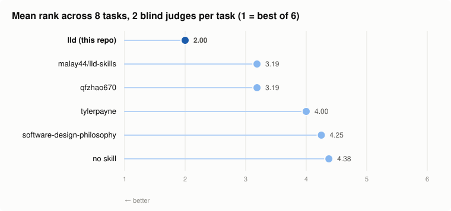
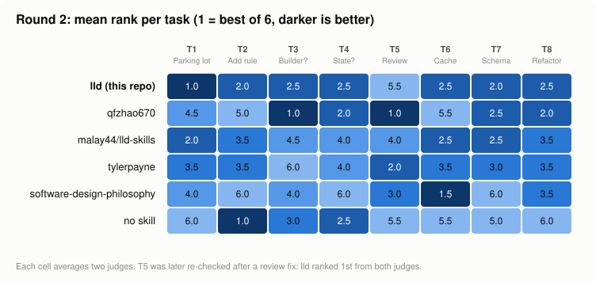

# lld

**Low-level design for coding agents.** Classes, APIs, data structures, design patterns, concurrency and tests, decided the way Gaurav Sen's free [InterviewReady Low Level Design course](https://interviewready.io/course-page/low-level-design-course) teaches them. Works in your real codebase and in interviews.

Most "design patterns" prompts make agents reach for patterns. This one makes them do what the course does: find the concrete problem first, pick the tool that removes it, say which option was rejected and why, and get correctness and thread safety right before extensibility.

```
You: add a "draw after 50 moves" rule to GameEngine.getState()

Without:  adds a seventh `if (...) return` to the method every feature already edits.
With lld: "getState is a chain of independent checks that every rule change edits (OCP smell).
           Move each check into a Rule object in an ordered list; the engine just loops.
           Rejected: wrapping getState in another layer, which adds a layer per feature.
           Watch out: if two rules depend on order, keep explicit if/else with named methods."
```

## Benchmark

`lld` was compared blind against four other low-level-design skills and against the same model with no skill. Full method, raw answers and every judge's scores: [evals/benchmark.md](evals/benchmark.md).

<picture>
  <source media="(prefers-color-scheme: dark)" srcset="assets/bench-rank-dark.svg">
  
</picture>

**Setup**

- **Contenders:** `lld` (this repo); [malay44/lld-skills](https://github.com/malay44/lld-skills), the closest rival (~60k words, 4 skills); [qfzhao670/low-level-design-skill](https://github.com/qfzhao670/low-level-design-skill) (SOLID + patterns, ~4k words); [tylerpayne/system-design-skill](https://github.com/tylerpayne/system-design-skill) (system-design interview with LLD guidance); [luoling8192/software-design-philosophy-skill](https://github.com/luoling8192/software-design-philosophy-skill) (Ousterhout's *A Philosophy of Software Design*, the most-starred); and no skill.
- **8 tasks:** parking-lot pricing with concurrent allocation, adding a rule to existing if-chain code, "Builder for a Point?", "State pattern for order status?", reviewing a thread-unsafe notification service, a concurrent TTL + LRU cache, a GitHub-style schema, and refactoring a growing discount class ([tasks](evals/bench/tasks.md)).
- **Answers:** one agent per setup, same model (Claude Opus 5.5), reading only its own skill files and picking the skill per task as a harness would.
- **Judging:** answers anonymised (skill names and lesson tags stripped) and shuffled to A-F, two independent judges per task, scored on a [rubric](evals/bench/rubric.md) written before any answer existed: a per-task checklist, correctness, design, decision clarity, proportionality, and a full ranking.

**Results**

| Setup | Mean rank | Wins | Checklist | Correctness | Design | Decision clarity | Proportionality | Words (8 tasks) |
|---|---|---|---|---|---|---|---|---|
| **lld** | **2.00** | **6/16** | 100% | **8.6** | **8.8** | **9.0** | 7.9 | 7.6k |
| malay44/lld-skills | 3.19 | 2/16 | 100% | 8.4 | 8.2 | 8.0 | 7.9 | 7.7k |
| qfzhao670/low-level-design-skill | 3.19 | 4/16 | 97% | 7.9 | 8.1 | 8.3 | 8.3 | 6.7k |
| tylerpayne/system-design-skill | 4.00 | 0/16 | 97% | 8.1 | 8.3 | 8.4 | 6.2 | 9.2k |
| software-design-philosophy | 4.25 | 1/16 | 91% | 7.6 | 7.7 | 8.1 | 7.9 | 7.3k |
| no skill | 4.38 | 3/16 | 98% | 7.4 | 7.8 | 7.9 | 7.9 | 6.4k |

<picture>
  <source media="(prefers-color-scheme: dark)" srcset="assets/bench-tasks-dark.svg">
  
</picture>

**Where `lld` differs.** It averaged between 1st and 2.5th on all eight tasks; every other setup fell to 4th or worse on at least one. Judges credited it most for decision clarity: each answer names the problem, the chosen tool, the rejected option and when that choice would flip. It also caught correctness details others missed: computing a fee before closing a ticket, money in integer minor units rather than `double`, reading the clock once, and deliberate `ON DELETE` rules in schemas. In code review it kept findings inside the diff and tied severity to an observed failure rather than to a broken rule. Its answers were about the same length as the other skills'.

**Read with care.** Ranks moved by about +/-0.5 when the same answers were given to new judges, so the gap to malay44 and qfzhao670 (about 1.2 ranks) is meaningful but not large; the gap to no skill (2.4) is clear. `lld` was refined against earlier runs of this benchmark; the other skills were run as published. Each setup answered each task once. Every skill, and the bare model, hit 90%+ of the checklists: the differences are in correctness details, design judgement and right-sizing.

## How it was built

All 94 captioned videos of the course (about 30 hours, 97 lessons) were transcribed from the player's captions. One agent per video then analysed what the lesson teaches: the problem behind each technique, the decision rules (when, do, because, flips when), the rejected alternatives, the trade-offs, the smells, how it applies in production, and what interviewers probe. Those 94 analyses (~150k words) were merged by theme into the reference files below, deduplicated, with every rule tagged by the lesson it came from (`[L58]`). Where the instructor changed his mind or the course's own code had a bug (the logger's lock-while-waiting deadlock), the files say so and give the final position.

Three lessons had no captions and are not covered: the Strategy implementation video, and the two sessions with Keerti Purswani (mock LLD, IRCTC).

## What's inside

| Skill | Use it for |
|---|---|
| `lld` | The core. Triggers on design work: new module or service, feature on existing classes, pattern choice, thread safety, schema from features, interview problems. |
| `lld-review` | Design review of a diff, PR, files or design doc. Findings grouped Must / Should / Nice, each with a concrete failing case, the smallest fix, and the rule it breaks. |
| `lld-patterns` | "Which pattern fits?" in five lines, including "no pattern needed" and the rejected alternative. |
| `lld-interview` | Mock LLD / machine-coding interview (it interviews you, keeps time, probes, scores) or coach mode. |
| `lld-help` | Quick reference. |

Plus the `lld-designer` agent (Claude Code, Copilot CLI) for full design documents in their own context, and `AGENTS.md`: the compact always-on ruleset for agents without skills.

Reference library (`skills/lld/references/`, ~38k words, loaded on demand):

| File | What it answers |
|---|---|
| [workflow.md](skills/lld/references/workflow.md) | How to approach any design task; interview round types and timings; change requests on existing code |
| [decision-index.md](skills/lld/references/decision-index.md) | ~180 decision rules, one line each, grouped by the situation you are in |
| [principles-and-smells.md](skills/lld/references/principles-and-smells.md) | SOLID, DRY and its overfitting trap, composition, naming; 40-row smell -> fix table; refactoring method |
| [patterns.md](skills/lld/references/patterns.md) | Picker table plus ~20 patterns: when, when not, sketch, the pitfall the course hit |
| [concurrency-and-async.md](skills/lld/references/concurrency-and-async.md) | Locks vs keyed executors vs snapshots, ordering, read-your-writes, futures, request collapsing, retries, DLQ, back pressure, fail-open |
| [data-modeling-and-apis.md](skills/lld/references/data-modeling-and-apis.md) | Entities and value objects, schema from access patterns, API signatures, choosing data structures |
| [testing.md](skills/lld/references/testing.md) | Deterministic tests, stubbing changeable algorithms, concurrency tests |
| [review-checklist.md](skills/lld/references/review-checklist.md) | Yes/no review questions with a severity guide |
| [interview.md](skills/lld/references/interview.md) | Round types, budgets, probes per problem, mock rubric |
| [case-studies/](skills/lld/references/case-studies/README.md) | 17 worked designs: game engine, tic-tac-toe, chess, Splitwise, cache, event bus, rate limiter, logger, orchestrator, calendar, Zerodha, live scores, Twitter, message queue, coupon engine, Git schema, delivery assignment; plus nearest neighbours for parking lot, elevator, BookMyShow and others |

## Install

**Claude Code** (two prompts):

```
/plugin marketplace add aryabharat/lld-skill
```
```
/plugin install lld@lld-skill
```

**Codex:**

```bash
codex plugin marketplace add aryabharat/lld-skill
```
```bash
codex plugin add lld@lld-skill
```

**OpenCode:**

OpenCode supports these `SKILL.md` files directly; no separate plugin package is needed. Clone the repo once (or use your existing clone):

```bash
git clone https://github.com/aryabharat/lld-skill.git "$HOME/lld-skill"
```

For all projects:

```bash
mkdir -p "${XDG_CONFIG_HOME:-$HOME/.config}/opencode/skills"
cp -R "$HOME/lld-skill/skills/." "${XDG_CONFIG_HOME:-$HOME/.config}/opencode/skills/"
```

Or, for one project only, run from that project's root:

```bash
mkdir -p .opencode/skills
cp -R "$HOME/lld-skill/skills/." .opencode/skills/
```

Copy all five skills together: the smaller skills use the core `lld` reference library. Before copying, back up any existing `lld`, `lld-help`, `lld-interview`, `lld-patterns` or `lld-review` folders at the destination; matching files will be overwritten. To update, run `git -C "$HOME/lld-skill" pull --ff-only` and repeat the copy for your chosen destination.

Ask normally and OpenCode can choose a relevant skill, or mention one explicitly, for example `@lld`, `@lld-review` or `@lld-interview`. These are skills, not OpenCode slash commands.

**GitHub Copilot CLI:**

```bash
copilot plugin marketplace add aryabharat/lld-skill
```
```bash
copilot plugin install lld@lld-skill
```

**Gemini CLI / Qwen Code:**

```bash
gemini extensions install https://github.com/aryabharat/lld-skill
```

**Agents that read `SKILL.md` folders** (Cline, Factory Droid, Freebuff, Command Code, Goose, Muse and others): copy every folder under `skills/` into the agent's skills directory (for example `~/.agents/skills/` or `~/.claude/skills/`). Copy all five together: the smaller skills point at `../lld/references/`.

**Rule-file agents** (always-on rules, no on-demand references):

| Agent | File |
|---|---|
| Cursor | `.cursor/rules/lld.mdc` |
| Windsurf | `.windsurf/rules/lld.md` |
| Cline | `.clinerules/lld.md` |
| Kiro | `.kiro/steering/lld.md` |
| GitHub Copilot (IDE) | `.github/copilot-instructions.md` |
| Antigravity | `.agents/rules/lld.md` |
| Zed, Amp, Jules, Junie, Codex extension, anything else | `AGENTS.md` in the project root |

Copy the file into the same path in your project. They are generated from `AGENTS.md`.

## Use

Ask normally. The core skill triggers on design work:

- "Design the classes for a parking lot with weekday pricing and concurrent arrivals."
- "Add refunds to this payment module without touching the settlement code."
- "Is this cache thread-safe?"
- "Strategy or State for order status?"
- "lld review my staged changes" (or `/lld-review` where supported)
- "mock interview me on Splitwise" (or `/lld-interview rate limiter 45` where supported)

## Develop

```bash
npm test
```

The tests check manifest versions, skill frontmatter, that every relative link resolves, and that the host rule files match `AGENTS.md`. After editing `AGENTS.md`, run `npm run sync`. [evals/cases.md](evals/cases.md) lists prompts and the behaviours a good answer must show, for comparing answers with and without the plugin.

## Credit and license

The ideas belong to Gaurav Sen and InterviewReady; take the course for the full explanations, the code, and the three lessons not covered here. This repo contains only original summaries and decision rules written from the lessons, not transcripts or the course's code. MIT for this repo's text and scripts.
