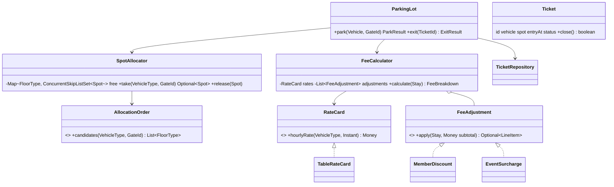

# Parking lot: fee calculation and spot allocation

## 1. Assumptions and skipped scope

- One lot, one lot-controller process. Entry and exit gates are clients that call it concurrently. The DB is the record of tickets; the controller keeps an in-memory index of free spots, rebuilt from the DB at startup.
- Spot types: `BIKE`, `CAR`, `LARGE`. A vehicle may use its own type or a larger one (bike -> car spot if bike spots are full; truck only `LARGE`).
- Fee is computed at exit from entry and exit instants. Billing unit is the started hour. Each hour is priced by the rate that applies at the start of that hour, so a stay from Friday 22:00 to Saturday 02:00 pays two weekday hours and two weekend hours. This rule also makes the coming night rate a pure data change.
- Money is `long` paise in a `Money` value object, never `double`.
- Skipped: payment, reservations, displays, EV charging, lost tickets. Named in section 11.

## 2. Core requirements

1. `park(vehicle, gate)` returns a ticket with a spot, or "lot full". Two gates can never get the same spot.
2. `exit(ticketId)` computes the fee with an itemised breakdown and frees the spot exactly once.
3. Pricing varies by vehicle type and weekday/weekend, and night rate, member discount and event surcharge can be added without editing the fee calculator.

## 3. Entities and responsibilities

| Class | Owns | Notes |
|---|---|---|
| `ParkingLot` | the public API: `park`, `exit` | coordinator, no pricing or allocation logic |
| `SpotAllocator` | free-spot index per (floor, spot type) | the only place spots are taken and returned |
| `Spot` | id, floor, type, distance rank | immutable value |
| `Ticket` | id, vehicle, spot, entry time, status | status `ACTIVE -> CLOSED`, closed once |
| `FeeCalculator` | turns a stay into a `FeeBreakdown` | knows how to run tariff + adjustments, not what they are |
| `RateCard` | base hourly rate for (vehicle type, instant) | data: weekday/weekend today, night bands later |
| `DayTypeCalendar` | weekday / weekend (later: public holiday) | injected so holidays are data |
| `FeeAdjustment` | one surcharge or discount | member discount, event surcharge: new classes |
| `FeeBreakdown` | line items and total | finance and receipts read this |

Has-a everywhere. No `CarSpot extends Spot` or `TruckFee extends Fee`: types are enums, and pricing differences are rows in the rate card.

## 4. API

```java
ParkResult park(Vehicle vehicle, GateId gate);          // Parked(ticket) | LotFull
ExitResult exit(TicketId ticketId);                     // Paid(breakdown) | AlreadyClosed | UnknownTicket
FeeBreakdown quote(TicketId ticketId);                  // "how much if I leave now", no side effects
```

Result types, not booleans or nulls: there are more than two outcomes and the caller needs the ticket or the breakdown.

## 5. Class diagram



Main sequence: gate -> `park` -> `allocator.take` (atomic) -> `tickets.insert` (if it fails, `allocator.release`) -> ticket. Exit: `exit` -> `ticket.close()` (atomic, once) -> `feeCalculator.calculate(stay)` -> `allocator.release(spot)`.

## 6. Algorithm and data structures

**Allocation.** For each (floor, spot type) keep a `ConcurrentSkipListSet<Spot>` of free spots ordered by distance rank from the lift/entry. `take` walks candidate (floor, type) pairs in the order the `AllocationOrder` gives (nearest floor first; own type before larger type) and calls `pollFirst()`.

| Operation | Cost |
|---|---|
| `take` | O(F x T x log S) worst case, F floors, T compatible types; usually the first set has a spot |
| `release` | O(log S) |
| free count per floor/type (display board) | O(1) with an `AtomicInteger` per set, or `size()` O(S) if rarely read |

**Fee.** Walk the stay one billing hour at a time; ask the rate card for each hour's rate; sum into a subtotal; then run adjustments in their declared order. A 3-day stay is 72 lookups, which is nothing. If stays of months appear, group consecutive hours with the same rate band (named, not built).

## 7. Patterns used and rejected

| Choice | Decision | Why |
|---|---|---|
| Rate card as data (`TableRateCard`) behind `RateCard` | Used | Vehicle type x day type is a table, not behaviour. Night rate = add a time band; no class per combination |
| Ordered list of `FeeAdjustment` | Used | Member discount and event surcharge are independent additions. Each is a new class plus one line of wiring; `FeeCalculator` does not change |
| Strategy per vehicle type (`CarPricing`, `TruckPricing`) | Rejected | Pricing differs only in numbers; classes per type would multiply with day type and night band (3 x 2 x 2 classes) |
| A `Set` or unordered rule engine for adjustments | Rejected | Order matters: a 10% member discount before or after a flat event surcharge gives different totals. The order is explicit in one wiring list and pinned by a test |
| `Strategy` for allocation order (`AllocationOrder`) | Used | "Nearest to gate", "fill lowest floor first" and "keep large spots for trucks" are real product options picked by config |
| State pattern for ticket | Rejected | Two states and one transition; an enum plus `compareAndSet` is enough |
| Singleton `ParkingLot` | Rejected | DI scope; tests need fresh instances |

## 8. Concurrency and failure plan

Shared mutable state and its mechanism:

| State | Mechanism | Why |
|---|---|---|
| Free spots per (floor, type) | `ConcurrentSkipListSet.pollFirst()` | `pollFirst` is atomic: of two gates racing for the last spot, exactly one gets it, the other gets `null` and moves to the next set. No check-then-act (`isFree()` then `occupy()`), which is the classic double-allocation bug |
| Ticket status | `AtomicReference<Status>` / conditional DB update `UPDATE ticket SET status='CLOSED' WHERE id=? AND status='ACTIVE'` | Two exit taps (gate retry, double scan) must free the spot and charge once |
| Spot occupancy in the DB | unique index on `ticket(spot_id) WHERE status='ACTIVE'` | Backstop: if a bug or a second controller ever hands out the same spot, the insert fails instead of two cars sharing it |

- Rejected: one `synchronized` around the whole lot. It is correct and honestly fast enough for gate traffic (a few cars per second), so it is a fine first version. The per-set atomic poll is equally short and lets gates on different floors proceed in parallel, so I take it. Rejected harder: a lock per spot, which still needs a scan with check-then-act.
- Allocation is not perfectly "nearest": if a closer spot is released while a gate is scanning further floors, that gate may get a farther spot. Acceptable; no spot is ever double-booked.
- Failure: if the ticket insert fails after `take`, release the spot in `finally`-style compensation. If the controller crashes, rebuild the free index from `spots minus active tickets` at startup.
- Gate calls do DB IO. Gates are few and the operation is short, so a blocking call on the gate's own thread is fine. If the controller sits behind a web server, return `CompletableFuture` and run the DB write on a bounded executor.
- Time: a `Clock` is injected. Domain code never calls `System.currentTimeMillis()`.

## 9. Code for the critical path

```java
public record Money(long paise) {
  public static final Money ZERO = new Money(0);
  public Money plus(Money o)  { return new Money(Math.addExact(paise, o.paise)); }
  public Money minus(Money o) { return new Money(Math.subtractExact(paise, o.paise)); }
  public Money percent(int pct) { return new Money(Math.round(paise * pct / 100.0)); }
}

public enum VehicleType { BIKE, CAR, TRUCK }
public enum SpotType   { BIKE, CAR, LARGE }
public enum DayType    { WEEKDAY, WEEKEND }

public record Spot(String id, int floor, SpotType type, int distanceRank) {}
public record FloorType(int floor, SpotType type) {}
public record Stay(Vehicle vehicle, Instant entry, Instant exit) {}
public record LineItem(String code, String description, Money amount) {}   // amount negative for discounts
public record FeeBreakdown(List<LineItem> items, Money total) {}
```

### Allocation

```java
public final class SpotAllocator {
  private static final Comparator<Spot> NEAREST =
      Comparator.comparingInt(Spot::distanceRank).thenComparing(Spot::id);

  private final Map<FloorType, ConcurrentSkipListSet<Spot>> free = new ConcurrentHashMap<>();
  private final AllocationOrder order;

  public SpotAllocator(Collection<Spot> freeSpots, AllocationOrder order) {
    this.order = order;
    for (Spot s : freeSpots) setFor(s.floor(), s.type()).add(s);
  }

  /** Atomic per set: two gates can never receive the same spot. */
  public Optional<Spot> take(VehicleType vehicle, GateId gate) {
    for (FloorType ft : order.candidates(vehicle, gate)) {
      Spot s = free.getOrDefault(ft, EMPTY).pollFirst();
      if (s != null) return Optional.of(s);
    }
    return Optional.empty();
  }

  public void release(Spot s) {
    if (!setFor(s.floor(), s.type()).add(s))
      throw new IllegalStateException("spot released twice: " + s.id());
  }

  private ConcurrentSkipListSet<Spot> setFor(int floor, SpotType type) {
    return free.computeIfAbsent(new FloorType(floor, type), k -> new ConcurrentSkipListSet<>(NEAREST));
  }
  private static final ConcurrentSkipListSet<Spot> EMPTY = new ConcurrentSkipListSet<>(NEAREST);
}

/** Which (floor, spot type) pairs to try, in order. Swappable by config. */
public interface AllocationOrder { List<FloorType> candidates(VehicleType v, GateId gate); }

public final class NearestFloorFirst implements AllocationOrder {
  private static final Map<VehicleType, List<SpotType>> FITS = Map.of(
      VehicleType.BIKE,  List.of(SpotType.BIKE, SpotType.CAR),
      VehicleType.CAR,   List.of(SpotType.CAR, SpotType.LARGE),
      VehicleType.TRUCK, List.of(SpotType.LARGE));
  private final Map<GateId, List<Integer>> floorsByDistance;   // precomputed per gate
  public NearestFloorFirst(Map<GateId, List<Integer>> floorsByDistance) { this.floorsByDistance = floorsByDistance; }

  public List<FloorType> candidates(VehicleType v, GateId gate) {
    List<FloorType> out = new ArrayList<>();
    for (SpotType t : FITS.get(v))                       // own type on every floor before a larger type
      for (int floor : floorsByDistance.get(gate)) out.add(new FloorType(floor, t));
    return out;
  }
}
```

### Lot API

```java
public final class ParkingLot {
  private final SpotAllocator allocator;
  private final TicketRepository tickets;
  private final FeeCalculator fees;
  private final Clock clock;

  public ParkResult park(Vehicle v, GateId gate) {
    Optional<Spot> spot = allocator.take(v.type(), gate);
    if (spot.isEmpty()) return ParkResult.lotFull();
    Ticket t = Ticket.open(TicketId.random(), v, spot.get(), clock.instant());
    try {
      tickets.insert(t);                                   // unique(spot_id) where ACTIVE as backstop
    } catch (RuntimeException e) {
      allocator.release(spot.get());                       // never leak a spot
      throw e;
    }
    return ParkResult.parked(t);
  }

  public ExitResult exit(TicketId id) {
    Optional<Ticket> found = tickets.find(id);
    if (found.isEmpty()) return ExitResult.unknown(id);
    Ticket t = found.get();
    Instant now = clock.instant();                         // read the clock once
    if (!tickets.closeIfActive(id, now)) return ExitResult.alreadyClosed(id);   // conditional update
    FeeBreakdown fee = fees.calculate(new Stay(t.vehicle(), t.entryAt(), now));
    allocator.release(t.spot());
    return ExitResult.paid(t, fee);
  }
}
```

### Fee calculation

```java
public interface RateCard { Money hourlyRate(VehicleType v, ZonedDateTime hourStart); }

public final class TableRateCard implements RateCard {
  private final Map<VehicleType, Map<DayType, Money>> rates;   // loaded from config/DB
  private final DayTypeCalendar calendar;                       // weekend today, holidays later
  public Money hourlyRate(VehicleType v, ZonedDateTime hourStart) {
    Money r = rates.getOrDefault(v, Map.of()).get(calendar.dayType(hourStart.toLocalDate()));
    if (r == null) throw new IllegalStateException("no rate for " + v + " on " + hourStart);
    return r;
  }
}

public interface FeeAdjustment {
  /** Empty when the adjustment does not apply. Amount is signed: + surcharge, - discount. */
  Optional<LineItem> apply(Stay stay, Money subtotal);
}

public final class FeeCalculator {
  private final RateCard rates;
  private final List<FeeAdjustment> adjustments;    // ORDER MATTERS: surcharges, then discounts
  private final ZoneId zone;

  public FeeCalculator(RateCard rates, List<FeeAdjustment> adjustments, ZoneId zone) {
    this.rates = rates; this.adjustments = List.copyOf(adjustments); this.zone = zone;
  }

  public FeeBreakdown calculate(Stay stay) {
    if (stay.exit().isBefore(stay.entry())) throw new IllegalArgumentException("exit before entry: " + stay);
    long hours = Math.max(1, ceilDiv(Duration.between(stay.entry(), stay.exit()).toMinutes(), 60));

    List<LineItem> items = new ArrayList<>();
    Money subtotal = Money.ZERO;
    ZonedDateTime hourStart = stay.entry().atZone(zone);
    for (long h = 0; h < hours; h++, hourStart = hourStart.plusHours(1)) {
      subtotal = subtotal.plus(rates.hourlyRate(stay.vehicle().type(), hourStart));
    }
    items.add(new LineItem("PARKING", hours + " h", subtotal));

    Money total = subtotal;
    for (FeeAdjustment a : adjustments) {
      Optional<LineItem> li = a.apply(stay, total);
      if (li.isPresent()) { items.add(li.get()); total = total.plus(li.get().amount()); }
    }
    if (total.paise() < 0) total = Money.ZERO;
    return new FeeBreakdown(List.copyOf(items), total);
  }

  private static long ceilDiv(long a, long b) { return -Math.floorDiv(-a, b); }
}
```

A future adjustment, to show it is an addition only:

```java
public final class MemberDiscount implements FeeAdjustment {
  private final Memberships members; private final int pct;
  public Optional<LineItem> apply(Stay s, Money subtotal) {
    if (!members.isMember(s.vehicle().plate())) return Optional.empty();
    return Optional.of(new LineItem("MEMBER", pct + "% member discount", Money.ZERO.minus(subtotal.percent(pct))));
  }
}
```

## 10. Tests

All with a fixed `Clock` and `ZoneId`, fake `TicketRepository` (in-memory map) and numbers you can check by hand. Rates in fixtures: car 40/h weekday, 60/h weekend; bike 10/20; truck 100/150.

Fee (`FeeCalculatorTest`, table-driven):
- Car, Wednesday 10:00 -> 13:00: 3 h x 40 = 120.
- Car, Wednesday 10:00 -> 13:01: started hour counts, 4 h = 160. And 10:00 -> 10:00: minimum 1 h = 40.
- Car, Friday 22:00 -> Saturday 02:00: 2 x 40 + 2 x 60 = 200 (day-boundary split).
- Bike, Sunday 09:00 -> 11:00: 2 x 20 = 40. Truck weekday 1 h = 100.
- Exit before entry throws.
- Adjustment order: subtotal 200, event surcharge +50, member 10% -> 250 - 25 = 225. Swap the order in wiring and the golden test fails, so the order is pinned.
- Breakdown lists every line item and the total equals their sum.
- `TableRateCard` and `DayTypeCalendar` tested on their own (a holiday on a Monday returns WEEKEND once holidays are added).

Allocation (`SpotAllocatorTest`):
- Truck never gets a CAR or BIKE spot; returns empty when only car spots are free.
- Bike falls back to a car spot only when bike spots are full.
- Nearest spot on the nearest floor is returned first.
- Release then take returns the same spot; double release throws.

Lot flow (`ParkingFlowTest`):
- Park then exit: correct fee, spot is free again.
- Full lot returns `LotFull`, not an exception.
- Second exit on the same ticket returns `AlreadyClosed`; spot released once.
- Ticket insert fails -> spot is back in the free set.

Concurrency:
- 10 free spots, 200 threads from 8 "gates" call `park` behind a `CountDownLatch` start gun: exactly 10 `Parked`, 190 `LotFull`, 10 distinct spot ids. Repeat 500 times in CI.
- Mixed park/exit storm with random interleaving; at the end, free spots + active tickets = total spots and no spot appears twice.
- 50 threads call `exit` on one ticket: exactly one `Paid`.

## 11. How the next requirements slot in

- **Night rate:** `TableRateCard` gains a time band dimension (`(vehicle, dayType, band) -> rate`) or a `NightBandRateCard` decorator. `FeeCalculator` unchanged, because it already prices each hour by its start instant.
- **Member discount / event surcharge:** new `FeeAdjustment` classes added to the wiring list; event dates come from an injected `EventCalendar`.
- **Public holidays:** `DayTypeCalendar` reads a holiday table.
- **Daily cap ("max 300 per day"):** an adjustment that groups hours by date; if it needs per-day subtotals, `FeeCalculator` exposes the hour list to adjustments via `Stay`/a `PricedHours` object.
- **EV spots, reserved spots:** new `SpotType` values and an `AllocationOrder` that skips them unless the vehicle qualifies.
- **Multiple lots / controller instances:** the DB conditional write becomes the source of truth (`UPDATE spot SET ticket_id=? WHERE id=? AND ticket_id IS NULL`, try the next candidate on 0 rows), with the in-memory index only as a hint.
