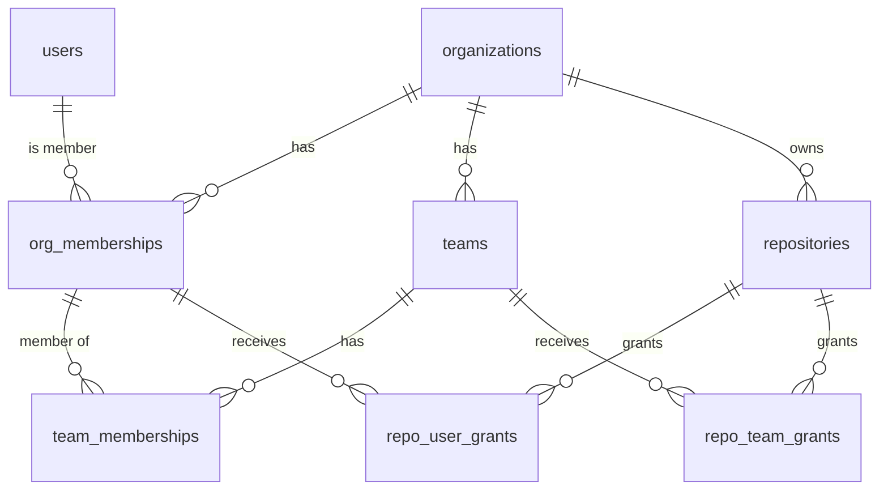

# Schema: organisations, members, teams, repositories, access grants

## 1. Features -> queries

What we store comes from the features; how we store it comes from the queries we will run. The features in scope:

1. A user belongs to an organisation as `MEMBER` or `ADMIN`.
2. An organisation owns repositories.
3. Access to a repository is granted to a user directly, or to a team (a group of org members).

The queries those features produce, roughly by frequency:

| # | Query | Frequency |
|---|---|---|
| Q1 | Effective permission of user U on repo R (every git push/pull, every page view) | very hot |
| Q2 | Repositories U can see (dashboard, search) | hot |
| Q3 | Organisations U belongs to | hot |
| Q4 | Is U a member / admin of org O | hot (part of Q1) |
| Q5 | Members / admins / teams of org O; members of team T | medium |
| Q6 | Who has access to repo R and why (repo settings page) | low |
| Q7 | Teams U belongs to in org O | medium |

Assumptions: Postgres; repositories are owned only by organisations here (user-owned repos are out of scope, see section 5); permission levels are `READ < TRIAGE < WRITE < MAINTAIN < ADMIN`; org admins implicitly have `ADMIN` on every repo of their org; an org has a base permission for all members (may be `NONE`); teams are flat (no nested teams).

## 2. Tables

```sql
CREATE TABLE users (
  id          BIGINT PRIMARY KEY,
  login       TEXT NOT NULL,
  email       TEXT NOT NULL,
  created_at  TIMESTAMPTZ NOT NULL DEFAULT now()
);
CREATE UNIQUE INDEX users_login_uq ON users (lower(login));
CREATE UNIQUE INDEX users_email_uq ON users (lower(email));

CREATE TABLE organizations (
  id                     BIGINT PRIMARY KEY,
  login                  TEXT NOT NULL,
  base_repo_permission   SMALLINT NOT NULL DEFAULT 0,      -- 0 NONE, 10 READ, 30 WRITE ...
  created_at             TIMESTAMPTZ NOT NULL DEFAULT now()
);
CREATE UNIQUE INDEX organizations_login_uq ON organizations (lower(login));

-- membership: one row per (org, user), never a list column on organizations
CREATE TABLE org_memberships (
  org_id      BIGINT NOT NULL REFERENCES organizations(id) ON DELETE CASCADE,
  user_id     BIGINT NOT NULL REFERENCES users(id)         ON DELETE CASCADE,
  role        TEXT   NOT NULL CHECK (role IN ('MEMBER','ADMIN')),
  created_at  TIMESTAMPTZ NOT NULL DEFAULT now(),
  PRIMARY KEY (org_id, user_id)                    -- Q4, Q5 (members of O)
);
CREATE INDEX org_memberships_user_idx  ON org_memberships (user_id);                     -- Q3
CREATE INDEX org_memberships_admins_idx ON org_memberships (org_id) WHERE role = 'ADMIN'; -- Q5 admins

CREATE TABLE teams (
  id          BIGINT PRIMARY KEY,
  org_id      BIGINT NOT NULL REFERENCES organizations(id) ON DELETE CASCADE,
  slug        TEXT NOT NULL,
  name        TEXT NOT NULL,
  UNIQUE (org_id, slug),                           -- URL lookup, teams of O
  UNIQUE (org_id, id)                              -- target for the composite FKs below
);

-- a team member must be a member of the team's org: enforced by composite FKs
CREATE TABLE team_memberships (
  org_id      BIGINT NOT NULL,
  team_id     BIGINT NOT NULL,
  user_id     BIGINT NOT NULL,
  PRIMARY KEY (team_id, user_id),                  -- members of T; join from team grants
  FOREIGN KEY (org_id, team_id) REFERENCES teams (org_id, id)                  ON DELETE CASCADE,
  FOREIGN KEY (org_id, user_id) REFERENCES org_memberships (org_id, user_id)   ON DELETE CASCADE
);
CREATE INDEX team_memberships_user_idx ON team_memberships (user_id, org_id);  -- Q1, Q2, Q7

CREATE TABLE repositories (
  id          BIGINT PRIMARY KEY,
  org_id      BIGINT NOT NULL REFERENCES organizations(id) ON DELETE RESTRICT,
  name        TEXT NOT NULL,
  visibility  TEXT NOT NULL CHECK (visibility IN ('PRIVATE','INTERNAL','PUBLIC')),
  created_at  TIMESTAMPTZ NOT NULL DEFAULT now(),
  UNIQUE (org_id, id)
);
CREATE UNIQUE INDEX repositories_name_uq ON repositories (org_id, lower(name));  -- URL lookup, repos of O

-- direct grants to users; user must be an org member (outside collaborators: see section 5)
CREATE TABLE repo_user_grants (
  org_id      BIGINT NOT NULL,
  repo_id     BIGINT NOT NULL,
  user_id     BIGINT NOT NULL,
  permission  SMALLINT NOT NULL CHECK (permission IN (10,20,30,40,50)),
  granted_by  BIGINT NOT NULL REFERENCES users(id),
  granted_at  TIMESTAMPTZ NOT NULL DEFAULT now(),
  PRIMARY KEY (repo_id, user_id),                  -- Q1, Q6
  FOREIGN KEY (org_id, repo_id) REFERENCES repositories (org_id, id)          ON DELETE CASCADE,
  FOREIGN KEY (org_id, user_id) REFERENCES org_memberships (org_id, user_id)  ON DELETE CASCADE
);
CREATE INDEX repo_user_grants_user_idx ON repo_user_grants (user_id);           -- Q2

-- grants to teams
CREATE TABLE repo_team_grants (
  org_id      BIGINT NOT NULL,
  repo_id     BIGINT NOT NULL,
  team_id     BIGINT NOT NULL,
  permission  SMALLINT NOT NULL CHECK (permission IN (10,20,30,40,50)),
  granted_by  BIGINT NOT NULL REFERENCES users(id),
  granted_at  TIMESTAMPTZ NOT NULL DEFAULT now(),
  PRIMARY KEY (repo_id, team_id),                  -- Q1 (probe by repo), Q6
  FOREIGN KEY (org_id, repo_id) REFERENCES repositories (org_id, id) ON DELETE CASCADE,
  FOREIGN KEY (org_id, team_id) REFERENCES teams (org_id, id)        ON DELETE CASCADE
);
CREATE INDEX repo_team_grants_team_idx ON repo_team_grants (team_id);           -- Q2
```



## 3. Decisions and why

**Junction tables, not lists.** `organizations.admins = 'u1,u7,u9'` would make "is U an admin of O" a read of everyone, cannot be indexed, rewrites the row on every change (and contends with unrelated updates to the org row), and leaks the member list to anyone who loads it. One row per relationship makes every membership check an index seek and every change an insert or delete.

**Role on the membership row, not a separate admins table.** Admins are a small subset and are read with members most of the time. The partial index `WHERE role = 'ADMIN'` serves "list admins" without a second table. If admin lookups became their own hot path with a large org, a separate table is the alternative, at the cost of a join for "all members".

**Two typed grant tables, not one polymorphic ACL.** The general form is an ACL tuple table `(subject_type, subject_id, relation, object_id)`. With only two subject types, two tables keep real foreign keys (a grant to a deleted team cannot exist), cascade on deletion, and give each query a simple plan. I would move to the tuple form if subject types multiply (apps, deploy keys, nested teams) or if we adopt a Zanzibar-style authorisation service.

**Permission as an ordered `SMALLINT`.** Effective permission is the highest of several grants, so the level must be comparable: `MAX(permission)` works directly. Gaps (10, 20, 30...) leave room for a new level between existing ones. The application maps it to an enum.

**`org_id` carried on child rows, with composite foreign keys.** Strictly redundant (it is derivable from the team or repo), but it lets the database enforce two invariants for free: a team member is a member of that org, and a grant can only target a team or user of the repo's own org. Removing someone from the org cascades to their team memberships and direct grants, so access cannot outlive membership.

**Org-admin and base permissions are computed, not stored as grant rows.** Writing an ADMIN row per (admin, repo) would mean fan-out writes whenever an admin or a repo is added and stale rows when someone is demoted. They are resolved at query time from `org_memberships` and `organizations.base_repo_permission`.

**Case-insensitive unique logins and names** via `lower(...)` unique indexes, because URLs are case-insensitive.

## 4. The queries and the indexes they use

**Q1 effective permission of U on R** (the hot one):

```sql
SELECT GREATEST(
  COALESCE((SELECT 50 FROM org_memberships m
             WHERE m.org_id = r.org_id AND m.user_id = :u AND m.role = 'ADMIN'), 0),            -- PK
  COALESCE((SELECT o.base_repo_permission FROM org_memberships m JOIN organizations o ON o.id = m.org_id
             WHERE m.org_id = r.org_id AND m.user_id = :u), 0),                               -- PK
  COALESCE((SELECT g.permission FROM repo_user_grants g
             WHERE g.repo_id = r.id AND g.user_id = :u), 0),                                  -- PK
  COALESCE((SELECT MAX(tg.permission) FROM repo_team_grants tg
             JOIN team_memberships tm ON tm.team_id = tg.team_id AND tm.user_id = :u
             WHERE tg.repo_id = r.id), 0),                                                    -- PK, PK
  CASE WHEN r.visibility = 'PUBLIC' THEN 10 ELSE 0 END
) AS permission
FROM repositories r WHERE r.id = :r;
```

Every branch is a primary-key seek; the team branch probes the repo's few team grants and checks each against `team_memberships (team_id, user_id)`. This runs on every git operation, so I would also cache the result per `(user, repo)` for a short TTL and bump a per-org version on any membership/grant change to invalidate.

**Q2 repos U can see:** union of `repo_user_grants (user_id)`, `team_memberships (user_id) -> repo_team_grants (team_id)`, and for orgs where U is admin or the base permission is not NONE, all repos via `org_memberships (user_id) -> repositories (org_id, ...)`. Each step has its own index, listed in the DDL.

**Q3 my orgs:** `org_memberships (user_id)`. **Q4:** PK `(org_id, user_id)`. **Q5:** PK prefix `org_id`, the partial admin index, `teams (org_id, slug)`, `team_memberships` PK prefix `team_id`. **Q6:** PK prefixes `repo_id` on both grant tables. **Q7:** `team_memberships (user_id, org_id)`.

Every index above is tied to a named query; I would add none without one, and check each with `EXPLAIN` against realistic data.

## 5. Invariants the schema cannot hold, and what I would do

- **An org keeps at least one admin.** Demotion or removal locks the org row (`SELECT ... FROM organizations WHERE id = :o FOR UPDATE`), counts admins, and refuses the last one, in the same transaction.
- **Audit.** Permission changes go to an append-only `access_audit_log (id, org_id, actor_id, action, subject, object, old_permission, new_permission, at)`; grant tables hold only current state.
- **Concurrent grant edits** are upserts on the primary key (`INSERT ... ON CONFLICT (repo_id, user_id) DO UPDATE`), so two admins editing the same grant cannot create duplicates.

## 6. Next likely requirements

- **Outside collaborators** (non-members with access to one repo): drop the `(org_id, user_id)` membership FK from `repo_user_grants` and add a `collaborator` flag, or a separate `repo_collaborators` table so the member-only FK stays on the main table.
- **User-owned repositories:** an `owners` supertable (`id, type USER|ORG`) that both users and organizations reference, with `repositories.owner_id` pointing at it.
- **Nested teams:** `teams.parent_team_id` plus a `team_closure (ancestor_id, descendant_id)` table, so "teams U is in, including parents" stays one indexed join instead of a recursive walk on every permission check.
- **Temporary elevated access:** a signed, expiring token carrying the grant, so checks need no DB hit; or an `expires_at` column on grants filtered in Q1.
