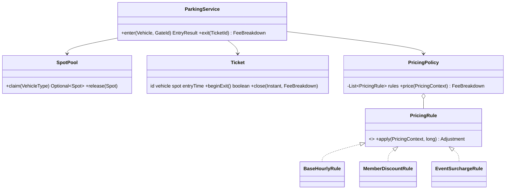

# Parking lot: fee calculation and spot allocation

## 1. Assumptions and skipped scope

- Fee is per started hour; minimum one hour. Each hour is priced by the day type at the start of that hour, so a stay from Friday 22:30 to Saturday 01:10 bills two weekday hours and one weekend hour. This also gives night rates a natural home (they are per-hour too).
- Money in integer paise (`long`). Percentages in basis points, rounded half-up to the paisa.
- Vehicle-to-spot fit: BIKE -> SMALL, MEDIUM, LARGE; CAR -> MEDIUM, LARGE; TRUCK -> LARGE. Smallest fitting size first; within a size, lowest floor then lowest number.
- Payment, displays, reservations and gate hardware are stubs. One process owns allocation; the DB variant is in section 8.
- Clock is injected; lot time zone is fixed in config.

## 2. Core requirements

1. `enter(vehicle, gate)` gives a ticket and a spot, or a clear "lot full", with no spot ever handed out twice when gates run concurrently.
2. `exit(ticketId)` computes the fee, closes the ticket once, and frees the spot.
3. Pricing grows by adding rules (night rate, member discount, event surcharge) without editing tested code, and the receipt shows which rules applied.

## 3. Entities

| Class | Responsibility |
|---|---|
| `Spot` (value: id, floor, number, size) | Immutable; ordered by (floor, number) |
| `SpotPool` | Owns the free spots per size; atomic claim and release |
| `Ticket` | id, vehicle, spot, entry time, state ACTIVE -> EXITING -> CLOSED (atomic) |
| `ParkingService` | Entry and exit flow; owns order of side effects |
| `PricingPolicy` | Ordered list of `PricingRule`s; returns a `FeeBreakdown` |
| `PricingRule` | One adjustment: base hourly table, night rate, member discount, event surcharge |
| `RateTable` | Paise per hour by (vehicle type, day type) |

`Vehicle` has a `VehicleType` enum, not subclasses: bikes, cars and trucks differ only by data (fit and rate), so `Car extends Vehicle` would be a mode-only subclass.



## 4. API

```java
EntryResult enter(Vehicle v, GateId gate);   // Admitted(ticket) | LotFull(type)
FeeBreakdown quote(TicketId id);             // price at "now", no state change
FeeBreakdown exit(TicketId id);              // price, close, release
```

`EntryResult` is a sealed result type rather than a nullable ticket, because "full" is a normal outcome, not an error.

## 5. Data structures and cost

| Operation | Structure | Cost |
|---|---|---|
| Claim a spot | `Map<SpotSize, ConcurrentSkipListSet<Spot>>`; `pollFirst()` per fitting size | O(log n) |
| Release | `add(spot)` | O(log n) |
| Find ticket | `ConcurrentHashMap<TicketId, Ticket>` | O(1) |
| Price | rules x billed hours | O(rules x hours) |

`pollFirst()` is a single atomic remove: two gates can both call it at the same instant and they get different spots, or one gets nothing. No check-then-act, no lock to forget. The sorted set also gives "lowest floor first" for free; a nearest-to-gate policy later becomes an `AllocationStrategy` holding one set per gate distance.

## 6. Patterns used and rejected

- **Ordered rule list for pricing (used).** Product has told us rules will keep coming, so each one is a class and `PricingPolicy` loops over them. The list is ordered on purpose: base, then surcharges, then percentage discounts, then caps. A member discount computed before an event surcharge gives a different number, so this is not an order-free rule set; the order is built in one place and pinned by a golden test.
- **Strategy per vehicle type (rejected).** The vehicles differ only by a rate in a table, not by algorithm. A `RateTable` keyed by (type, day type) is data.
- **Vehicle subclasses (rejected).** No behaviour differs.
- **Chain of Responsibility (rejected).** Rules are not first-match; every applicable rule contributes.
- **Locks per spot (rejected).** The concurrent sorted set already makes claim atomic.

## 7. Concurrency and failure plan

| Shared state | Mechanism |
|---|---|
| Free spots | `ConcurrentSkipListSet.pollFirst/add` (atomic per call) |
| Tickets | `ConcurrentHashMap` |
| Ticket state | `AtomicReference<State>` compare-and-set ACTIVE -> EXITING, so two exit taps cannot charge twice or release the spot twice |

Order of side effects:
- **Entry:** claim the spot, then create and store the ticket. If ticket creation throws, release the spot (compensation).
- **Exit:** read the clock once, compute the fee (can fail, changes nothing), CAS the ticket ACTIVE -> EXITING (only one caller wins), collect payment (stub; on failure revert to ACTIVE), mark CLOSED, then release the spot.

## 8. Code for the critical path

```java
public record Spot(String id, int floor, int number, SpotSize size) implements Comparable<Spot> {
  public int compareTo(Spot o) {
    int c = Integer.compare(floor, o.floor);
    return c != 0 ? c : Integer.compare(number, o.number);
  }
}

final class SpotPool {
  private final Map<SpotSize, ConcurrentSkipListSet<Spot>> free = new EnumMap<>(SpotSize.class);

  SpotPool(Collection<Spot> spots) {
    for (SpotSize s : SpotSize.values()) free.put(s, new ConcurrentSkipListSet<>());
    spots.forEach(sp -> free.get(sp.size()).add(sp));
  }
  Optional<Spot> claim(VehicleType type) {
    for (SpotSize size : type.fits()) {           // smallest fitting size first
      Spot s = free.get(size).pollFirst();        // atomic: no two callers get the same spot
      if (s != null) return Optional.of(s);
    }
    return Optional.empty();
  }
  void release(Spot s) { free.get(s.size()).add(s); }
}

final class ParkingService {
  private final SpotPool pool; private final PricingPolicy pricing;
  private final Clock clock; private final Map<TicketId, Ticket> tickets = new ConcurrentHashMap<>();

  EntryResult enter(Vehicle v, GateId gate) {
    Optional<Spot> spot = pool.claim(v.type());
    if (spot.isEmpty()) return new LotFull(v.type());
    try {
      Ticket t = new Ticket(TicketId.random(), v, spot.get(), clock.instant());
      tickets.put(t.id(), t);
      return new Admitted(t);
    } catch (RuntimeException e) { pool.release(spot.get()); throw e; }
  }

  FeeBreakdown exit(TicketId id) {
    Ticket t = Optional.ofNullable(tickets.get(id)).orElseThrow(() -> new UnknownTicket(id));
    Instant now = clock.instant();                                   // read once
    FeeBreakdown fee = pricing.price(new PricingContext(t, now));    // may throw, nothing changed yet
    if (!t.beginExit()) throw new TicketAlreadyClosed(id);          // CAS ACTIVE -> EXITING: one winner
    try { payments.collect(t, fee.totalPaise()); }                   // stub
    catch (RuntimeException e) { t.abortExit(); throw e; }           // EXITING -> ACTIVE
    t.close(now, fee);                                               // EXITING -> CLOSED
    pool.release(t.spot());
    return fee;
  }
}
```

Pricing:

```java
interface PricingRule {
  String name();
  long apply(PricingContext ctx, long runningPaise);   // returns the new running total
}

final class BaseHourlyRule implements PricingRule {
  private final RateTable rates; private final ZoneId zone;
  public String name() { return "BASE_HOURLY"; }
  public long apply(PricingContext ctx, long running) {
    long total = 0;
    for (ZonedDateTime h : ctx.billedHourStarts(zone))           // one per started hour, min 1
      total += rates.paisePerHour(ctx.vehicleType(), DayType.of(h.getDayOfWeek()));
    return running + total;
  }
}

final class MemberDiscountRule implements PricingRule {
  private final int discountBps;                                  // 1000 = 10%
  public String name() { return "MEMBER_DISCOUNT"; }
  public long apply(PricingContext ctx, long running) {
    if (!ctx.isMember()) return running;
    return running - Bps.of(running, discountBps);                // half-up to the paisa
  }
}

final class PricingPolicy {
  private final List<PricingRule> rules;                          // order fixed in one factory
  FeeBreakdown price(PricingContext ctx) {
    long running = 0; List<FeeLine> lines = new ArrayList<>();
    for (PricingRule r : rules) {
      long next = r.apply(ctx, running);
      if (next != running) lines.add(new FeeLine(r.name(), next - running));
      running = next;
    }
    return new FeeBreakdown(running, List.copyOf(lines));
  }
}

final class Bps {
  static long of(long paise, int bps) { return (paise * bps + 5_000) / 10_000; }   // half-up
}
```

**DB-backed variant.** If spots live in a table and several processes run gates, the claim becomes a conditional write: `UPDATE spot SET ticket_id = ? WHERE id = (SELECT id FROM spot WHERE size = ? AND ticket_id IS NULL ORDER BY floor, number LIMIT 1 FOR UPDATE SKIP LOCKED) RETURNING id`. It is the same find-select-persist idea, with the database as the atomic step.

## 9. Tests

All tests use a fake clock and rates you can work out by hand: car 4000 paise/h on weekdays and 6000 paise/h on weekends.

1. **Exact fee across midnight into the weekend:** a car parks Fri 22:30 to Sat 01:10. That is three started hours: 4000 + 4000 + 6000 = 14000.
2. **Member discount on the same stay:** 14000 - 1400 = 12600. The breakdown lines are `BASE_HOURLY 14000` and `MEMBER_DISCOUNT -1400`.
3. **Boundaries:** a 0-minute stay bills 1 hour. Exactly 60:00 bills 1 hour. 60:01 bills 2 hours.
4. **Rule order golden test:** the factory-built list is base, surcharges, discounts. The event surcharge applies before the member discount.
5. **Fit:** a bike takes SMALL first, then MEDIUM when SMALL is full. A truck gets `LotFull` when there is no LARGE spot, even if MEDIUM spots are free.
6. **Concurrency, one spot:** one free spot and 50 threads released together by a latch. Exactly one gets `Admitted`.
7. **Concurrency, many spots:** 200 spots and 1000 concurrent enters. Every admitted ticket has a distinct spot, and the admitted count plus the remaining free count equals 200.
8. **Double exit:** two concurrent `exit(id)` calls. One succeeds, payment is collected once, and the spot is released exactly once (the free count rises by 1).
11. **Payment failure:** the ticket returns to ACTIVE, the spot stays taken, and a retry of `exit` succeeds.
9. **Failure order:** pricing throws. The ticket stays ACTIVE and the spot stays taken.
10. **Entry compensation:** the ticket store throws. The spot goes back to the pool.

## 10. How the next requirements slot in

- **Night rate:** a new rule that reprices the hours whose start falls in 22:00-06:00. Add it after `BASE_HOURLY`. No existing class changes.
- **Event surcharge:** a rule with an injected `EventCalendar`.
- **Member discount** already exists above.
- **Per-floor or per-gate allocation:** replace the fixed size order with an `AllocationStrategy`, once a second allocation policy actually exists.
