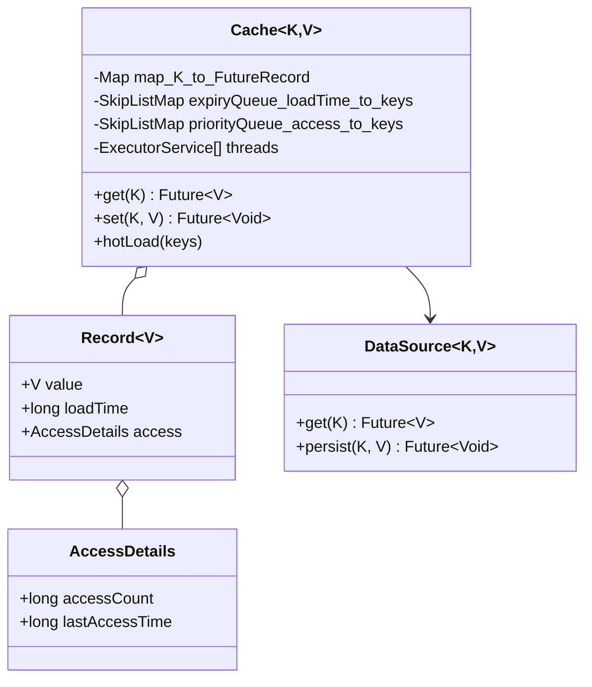

# Case study: in-process cache (machine coding)

Use this when writing a read-through / write-through cache, a loading cache with TTL and LRU/LFU eviction, or any per-key store where concurrent misses, read-your-writes and index consistency matter [L51-L59].

## 1. Problem and scope
- A cache is not get/put on a map. The design must say what a client sees after its own write, how entries expire, what gets evicted when full, and what happens on concurrent misses [L51, L53].
- Anomaly that drives the design: client writes A=Z, reads A before the DB acks, gets the old X [L52].
- Out of scope: cross-node write races for one key; assume keys are partitioned across cache nodes [L56].
- Machine-coding expectation: the whole thing running, with tests [L53].

## 2. Requirements (full -> shortlisted)
| # | Requirement | Short round |
|---|---|---|
| 1 | Read your own writes | Core |
| 2 | Write policies: write-through and write-back | Core |
| 3 | Expiry per entry | Core |
| 4 | Replacement: LRU and LFU | Core |
| 5 | Async results, reader threads never block on the DB | Built |
| 6 | Request collapsing (one DB load per key, shared result) | Built |
| 7 | Hot loading at startup | Built |
| 8 | Event logging (load, evict, replace, CRUD) to a log or queue | Built lightly |

Requirement 5 is inferred: the transcript skips it aloud, the next lesson covers it [L53]. Pick the core four for a short session; all eight only in a long round [L53].

Consistency choice: read-your-own-writes, not always-consistent. The strong version needs DB-to-cache notifications on every update [L51, L52].

## 3. Entities and APIs

- `set` returns `Future<Void>`: the caller already has the value and needs only an ack [L56].
- `CompletableFuture`, not plain `Future`: you need callbacks to compose, not `isDone()` polling [L56].
- Persistence policy and eviction policy are separate, constructor-injected, final. One enum named "eviction" that held WRITE_THROUGH was a smell [L56].
- The eviction policy is the comparator on `AccessDetails` (recency for LRU, count then recency for LFU). The cache body never branches on LRU vs LFU [L58].

## 4. Core algorithm and data structures
| Structure | Key -> value | Answers |
|---|---|---|
| `map` | key -> future of record | lookup, in-flight loads |
| `expiryQueue` | load time -> keys | oldest-loaded first (TTL) |
| `priorityQueue` | AccessDetails -> keys | least useful first (LRU / LFU) |

- One sorted index fails once expiry and LFU coexist: they are two independent orders [L56, L57].
- `ConcurrentSkipListMap` because a sorted concurrent map is needed and no concurrent TreeMap exists; buckets because several keys can share a timestamp or access tuple [L57, L58].
- Expiry is a function of load time, not access time; refreshing TTL on read was tried and reverted [L57].
- Capture `now` once per operation and convert TTL units once [L57].

`addToCache` is the only insert path (get-miss, set, hot load) [L58, L59]:
```java
CompletableFuture<Record<V>> addToCache(K key, CompletableFuture<V> value) {
  if (map.size() >= threshold) {
    dropExpiredHeads();                 // check head against now - ttl
    if (map.size() >= threshold) evictOne();
  }
  CompletableFuture<Record<V>> rec = value.thenApply(v -> {
    Record<V> r = new Record<>(v, now());
    expiryQueue.computeIfAbsent(r.loadTime, t -> new CopyOnWriteArrayList<>()).add(key);
    priorityQueue.computeIfAbsent(r.access, a -> new CopyOnWriteArrayList<>()).add(key);
    return r;
  });
  map.put(key, rec);                    // in-flight future visible at once
  return rec;
}
```
- `get`: route to the key's thread; if missing or expired, `addToCache(k, dataSource.get(k))`; on hit, update access details; return the value [L58, L59].
- `set`: on the key's thread, remove the old entry from the map and both indexes, then `addToCache` with `completedFuture(v)` (write-back) or `persist(k, v).thenApply(x -> v)` (write-through) [L59].
- Eviction: `firstEntry()` of the priority index, remove one key from its bucket and from its expiry bucket. `pollFirstEntry` would silently evict the whole bucket [L58].
- Expired entries are removed lazily, when full or when read; eager cleanup is for prompt memory reclaim (inferred) [L58].
- Map, index and bucket operations are O(log N) plus bucket size.

## 5. Concurrency
- **Async, not more threads.** A reader thread that waits on the DB blocks; 20 slow misses stall every reader and fast backends wait behind slow ones (head-of-line blocking). Acknowledge, return a future, fetch elsewhere. Thousands of threads cost memory and CPU [L54].
- **Read-your-writes by thread assignment.** Route every op on key K to executor `hash(K) % N`, each single-threaded, so the write runs before the later read. Needs both locality (same key, same thread) and sequential execution; a shared any-free-thread pool lets the read win on another core [L55, L58].
- Locks were kept as a valid option, not rejected; they need release and expiry policies. Ordering was chosen for this design [L55].
- **Request collapsing.** The map holds the future, so concurrent misses find the in-flight entry and share one DB load [L59].
- Only completed records enter the expiry index, so an evicted record is always complete [L59].

## 6. Patterns used and rejected
- Strategy via comparator and policy injection; single write path for invariants [L56, L58].
- Rejected: changing public `set` to return `Future<Record>` for internal reuse (private helper instead) [L57]; a policy field the cache branches on [L58]; evicting a whole bucket [L58]; full records in the priority index (keys suffice) [L58]; `addToCache(key, value)` plus wrapping at call sites, which hid the in-flight state and led to a `join()` hack [L59]; hot load writing straight into the map [L59]; dirty tracking for write-back (fire-and-forget persist instead) [L56].

## 7. Tests
The course ends before the test lesson for the cache. Shape to use (inferred from production notes of L55, L59):
- N concurrent gets for one missing key against a counting fake source: exactly one load, all callers get the same value.
- Interleaved set/get pairs from many threads: each get after a completed set sees at least that version; run with more workers than cores.
- Failed load followed by a retry that succeeds.
- Hot load K keys, then zero loads on later gets.
- Expiry with an injected clock; LRU and LFU victim order; equal timestamps; overwrite of an existing key.
- Load and Evict events fire exactly once each.

## 8. Extensions and trade-offs
- Write-through: consistent, caller waits on the DB. Write-back: fast, loses data on crash and is harder to debug. The instructor prefers write-through but says it depends [L51, L56].
- Future-valued map: collapsing and a non-blocking API, at the cost of reasoning about in-flight entries [L59].
- Two indexes: O(log N) to both victims, double bookkeeping on every write [L57].
- Thread-per-shard ordering: no locks, but head-of-line blocking inside a shard (inferred) [L58].
- Hot loading costs startup work and memory for keys that may never be read (inferred) [L53].

## 9. Pitfalls the course hit
- Index pollution: re-access added a new entry without removing the old [L58].
- Capacity checked only in `set`; moved into every `addToCache` [L58].
- Assuming the head of the time queue is expired without comparing to `now - ttl` [L58].
- Two clock reads making load and access times disagree; seconds compared to millis [L57].
- Getting a bucket without `computeIfAbsent`; plain `ArrayList` buckets under concurrency [L57].
- `join()` on a future "known" to be done [L59].

## 10. What transfers to production
- Single-flight loading is the in-process form of Caffeine `AsyncLoadingCache` or Go `singleflight` (named for reference) [L59].
- Reviewer checks (inferred unless noted): a failed load future must be removed or given a short TTL, or every reader gets the error; `thenApply` callbacks run on the thread that completed the DB future, so index writes may leave the key's stripe; in-flight placeholders count toward capacity; failed write-through must not resolve to the new value [L59 notes].
- Every read and write of a key goes through the same router; no slow task blocks its stripe; resizing N breaks ordering [L55 notes].
- Hot load in bounded batches so warm-up does not stampede the DB [L59 notes].
- Emit events for hit, load and evict so behaviour is observable [L53].
