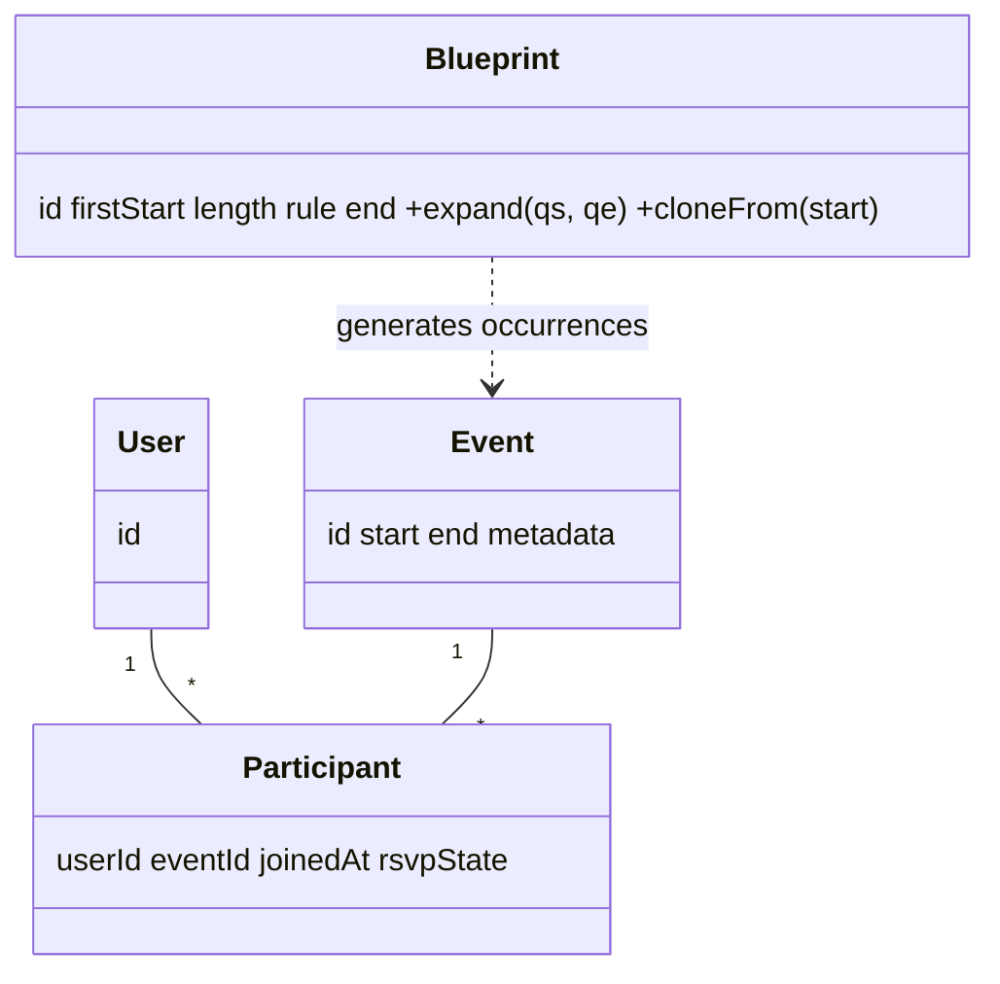

# Case study: calendar event scheduling (recurring events)

Use this when designing anything with repeating items (calendars, recurring billing, reminders, shift rosters, maintenance windows), or when an M:N relation and client-vs-server ID generation come up in a CRUD service. [L86]

## Problem and scope

Design the booking side of a Google Calendar-like product. Single events are trivial; recurring events are the real problem. Series can be unbounded (the instructor has a 50-year reminder, and the real product imposes no end), and "this and following" or "all events" edits would touch hundreds of rows and send hundreds of notifications if occurrences were stored. [L86]

## Requirements

**Full list (from the real UI):** book event, notifications, metadata (location, meeting link, notes), RSVP, recurring events, public/private visibility and sharing, delete, plans/subscriptions, SSO, invite users, show events for a date range. [L86]

**Parked deliberately:** notifications (separate service), metadata (opaque blob the client interprets), permissions (pointed to Google's Zanzibar paper), plans, SSO. RSVP is an update; invite is part of create. [L86]

**Shortlisted:** create event, update event, get events in a range, each hard only for recurrence. [L86]

## Entities and APIs

| Entity | Fields |
|---|---|
| `Event` | id, start, end, metadata |
| `User` | id, profile |
| `Participant` (join table) | userId, eventId, joinedAt, rsvpState |
| `Blueprint` | id, metadata, participants, firstStart, length, rule (cron-like), end (null = infinite) |

APIs, each carrying the acting user for authn/authz [L86]:

- `createEvent(user, id?, start, end, metadata, invitees, recurrence?)`
- `updateEvent(user, id, partialFields, scope)` with scope = this / this and following / all
- `getEvents(user, start, end)`



**ID generation decision** [L86]:

| Option | Gain | Cost |
|---|---|---|
| Server-generated | No collisions, simple client | Retries can create duplicates |
| Client-generated | Idempotent retry: resend "create 123", server returns 200/204 | Must be collision-proof: compose userId + timestamp + random, or Snowflake (time + machine + sequence) |

The instructor leaned toward client IDs. Start, end and metadata are not unique enough to dedupe. The ID is minted once at create; updates reuse it. [L86]

**M:N relation:** a separate participant table, because users-to-events is queried from both sides, carries its own attributes (RSVP, joinedAt), and an array column would bloat rows with stale data and cause lock contention with unrelated profile writes. Flips when only one access direction exists. [L86]

## Core algorithm and data structures

**Store a rule, not occurrences.** A blueprint is like a class; occurrences are objects generated on read for the requested window. [L86]

```java
List<Occurrence> expand(Blueprint b, Instant qs, Instant qe) {
  Instant t = firstAtOrAfter(b, max(qs, b.firstStart));  // jump, do not walk
  while (t.isBefore(qe) && (b.end == null || !t.isAfter(b.end))) {
    out.add(b.instanceAt(t)); t = b.rule.next(t);
  }
  return out;
}
```

- **Jump to the window:** advance by period x 1, 2, 4, 8 until past the query start, then binary search back, or compute directly for fixed periods. O(log n) instead of O(occurrences since start). [L86]
- **Empty windows:** a monthly rule queried for one week can yield nothing. [L86]
- **Rule format:** a restricted cron subset, because a list of days cannot express "third Friday of the month" (a student found this live). [L86]
- **getEvents** = single events via indexed join on start time + `expand()` over every blueprint overlapping the window. [L86]

**Edits split blueprints, O(1) writes regardless of series length** [L86]:

```java
void editFollowing(Blueprint b, Instant at, Patch p) {
  b.end = b.rule.prev(at); save(b); save(b.cloneFrom(at).apply(p));
}
void editSingle(Blueprint b, Instant at, Patch p) {
  b.end = b.rule.prev(at); save(b);
  save(oneOff(b, at).apply(p)); save(b.cloneFrom(b.rule.next(at)));
}
```

Editing the original blueprint in place would rewrite past occurrences; ending it and cloning keeps history. One notification per series change. [L86]

## Concurrency

The class did not go into locking. What it did cover: an embedded events array on the user row creates row-lock contention with unrelated profile updates, which is one reason for the join table. Wrap end + clone in one transaction so a reader never sees a gap or overlap at the split (inferred). Idempotent client IDs make concurrent retries safe. [L86]

## Patterns used and rejected

| Choice | Decision | Why |
|---|---|---|
| Prototype (`cloneFrom`) | Used | New blueprint starts as a copy of the old with a new start [L86] |
| Builder | Used | Build blueprints from partial update payloads [L86] |
| Class/instance analogy for rule vs occurrence | Used | Keeps the generator as the single source of truth [L86] |
| Participants array in events, or events list in users | Rejected | One-directional, stale bloat, lock contention [L86] |
| Map eventId -> list of days | Rejected | Cannot express nth-weekday rules; still materialises [L86] |
| Linked list / doubly linked list / tree of occurrences | Rejected | Still materialised and infinite; edits walk hundreds of nodes [L86] |
| Mutate the blueprint on edit | Rejected | Rewrites history [L86] |
| Linear stepping to the window | Rejected | Correct but O(n) [L86] |
| Cap horizon at one year | Accepted as a product option, not chosen | Real product has no cap [L86] |

## Tests

- `expand(rule, window)` equals naive stepping for random rules and windows (property test). [L86]
- Empty window (monthly rule, weekly query); far-future window performance. [L86]
- Split at the first and last occurrence; no duplicate or missing occurrence at the boundary. [L86]
- Clone keeps participants. [L86]
- Retry of create with the same client ID returns the existing event.
- Worked check: weekly series from April 2023, query 2-9 April 2024, series lands on 1, 8, 15 April -> returns only 8 April. [L86]

## Extensions and trade-offs

- **Materialise vs generate:** materialising makes reads trivial and per-occurrence data easy; generating keeps writes O(1) at the cost of compute on read. [L86]
- **Fixed horizon vs infinite:** a cap simplifies everything; infinite matches the real product. [L86]
- **Per-occurrence data** (a meeting link per instance): likely the same across the series and not generated far ahead. [L86]
- Delete, visibility and notifications plug in at the series level once the rule model exists (inferred).

## Pitfalls the course hit

- Students proposed hashmaps, linked lists and trees of stored occurrences before reaching the rule model. [L86]
- The range query shown only matched events starting in the window; the stated requirement was overlap, which needs `start < :end AND end > :start` (inferred correction). [L86]
- "Normalise it" without naming access patterns and contention is a weak justification. [L86]
- The API was left thin; be ready to justify each parameter. [L86]
- The instructor said that solving without patterns, he made more mistakes and took longer. [L86]

## What transfers to production

- iCal RRULE plus EXDATE/overrides is the industry form of the split/override idea; store rules and expand per window with a maximum expansion count (inferred). [L86]
- Time zones and DST: store the rule with a tz ID and expand in local time, so 9am stays 9am (inferred).
- Accept client idempotency keys scoped per user. [L86]
- Index the join table both ways, (user_id, event_id) and (event_id, user_id); keep RSVP there; keep hot unrelated fields off the users row. [L86]
- Index blueprints on (firstStart, end) to find candidates intersecting the window. [L86]
- Reviewer checks: O(1) writes per series edit, one domain event per change, capped expansion, overlap predicate, out-of-scope concerns delegated rather than half-built.
