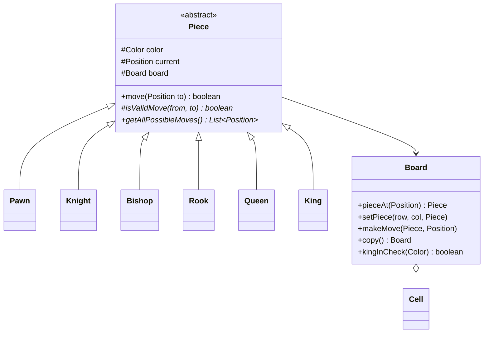

# Case study: chess

Use this when designing a domain with several entity types that share a workflow but differ in one step (chess pieces, payment methods, document validators), or when you face "design chess" in an LLD round. Source is a live-streamed machine-coding session [L82].

## 1. Problem and scope
- "Design an app that can play chess" is LLD: classes, behaviours, rules. Not the HLD of a chess site (connections, sharding, capacity). Ask which round it is; a wrong assumption fails the round [L82].
- Six piece types all move and capture, each differently; some have special moves (pawn double step, en passant, promotion; king castling) [L82].
- Named risk: committing to inheritance or composition in code too early and then backtracking. In the stream the class structure and that decision were settled on the whiteboard about 25 minutes in [L82].

## 2. Requirements (full -> shortlisted)
| Requirement | Decision |
|---|---|
| Each piece moves by its own rule | Build (`isValidMove` per piece) |
| Cannot capture own colour | Build (shared) |
| Cannot leave own king in check | Build (shared, simulate-then-check) |
| Capture, update position | Build (shared) |
| Flag check on the enemy king | Build (shared) |
| Pawn double step, promotion | Build or sketch |
| En passant, castling, full check detection | Name and stub; confirm out of scope [L82] |

Tests in an interview are basic at most; the aim is decomposition, not rule completeness [L82].

## 3. Entities and APIs
Method used: list entities, list behaviours per entity, then sort behaviours into "common to all" and "special to one". Common ones become the base abstraction [L82].

| Behaviour | Pawn | Knight | Bishop | Rook | Queen | King |
|---|---|---|---|---|---|---|
| move, capture, all possible moves, check enemy king | x | x | x | x | x | x |
| double step, en passant, promote | x | | | | | |
| castle | | | | | | x |


- "A rook is a piece" reads true; "a pawn has a mover" does not, so inheritance wins. Say the relationship aloud and pick the version that sounds right [L82].
- `Piece` started as an interface and became an abstract class once shared steps inside `move` appeared [L82].
- The board started as `Map<Position, Piece>` to stay at class level; it moved to an 8x8 `Cell[][]` when students asked [L82].
- `Color` enum drives own-colour checks and `kingInCheck(Color)` [L82].

## 4. Core algorithm and data structures
`move(to)` is a template method in the base class; only the geometric rule varies:
```java
final boolean move(Position to) {
  Piece target = board.pieceAt(to);
  if (target != null && target.color == color) return false;
  Board trial = board.copy();
  trial.makeMove(this, to);
  if (trial.kingInCheck(color)) return false;   // also allows blocking a check
  if (!isValidMove(current, to)) return false;  // per-piece rule
  if (target != null) capture(target);
  board.makeMove(this, to); current = to;
  if (board.kingInCheck(color.opposite())) flagCheck();
  return true;
}
```
- **Simulate then check.** Copy the board, apply, test the predicate, discard. It catches discovered checks and correctly permits moves that block or escape a check [L82].
- Cost: one board copy per candidate move; fine for an interview. Real engines use make/unmake and incremental hashing; the instructor's own engine used Zobrist hashing and guard tracking [L82].
- **Derive, do not store.** A pawn on its start rank has not moved (pawns never go back), so no `hasMoved` flag for the double step [L82]. Castling legality does need a has-moved flag for king and rook; the lesson does not cover it (inferred).
- A bishop keeps its colour automatically; no extra constraint [L82].

## 5. Concurrency
- Not discussed. One game is naturally single-writer; serialise moves per game id if several requests can arrive (inferred).
- The instructor floated making the board a singleton. That conflicts with the trial copies and with running several games; do not do it [L82 Q&A] (inferred judgement).

## 6. Patterns used and rejected
| Option | Verdict | Flips when |
|---|---|---|
| Abstract base + template method `move` | Used | Shared steps exist around one varying predicate [L82] |
| Composition (piece has a mover / strategy) | Rejected here | The capability is a part, or shared across unrelated types (inferred) [L82] |
| `Piece` as interface | Replaced | Fine while no shared logic exists [L82] |
| `type` field with `if (type == PAWN)` in the base | Rejected | Never; push the branch into an override. The instructor caught himself doing it [L82] |
| `board.getCell(r,c).setPiece(p)` | Rejected | Use `board.setPiece(r, c, p)`; the aggregate owns cells and is where validation goes [L82] |
| Prototype (board copy) | Used | Same idea as the game engine's AI trials [L13, L82] |

## 7. Tests
- The stream wrote none. Per-rule tests are the recommended shape: pawn double step only from the start rank, cannot capture own colour, cannot move into check, blocking a check is legal [L82].
- Refactoring an existing engine: pin current behaviour with tests first, start with the dirtiest module, draw the new design before editing [L82].

## 8. Extensions and trade-offs
- Inheritance gives shared move, capture and check logic for free; the cost is commitment, hence the whiteboard first [L82].
- An aggregate method is a tighter contract than a getter that leaks the inner object; it leaves room for validation later [L82].
- Back-references (piece -> board) simplify logic but couple the types and complicate copies; the trial copy must rebind them (inferred).
- Extensions to name: castling, en passant, check / checkmate / stalemate detection, move history and undo (replay, see `tic-tac-toe.md`), clocks (composed config, see `game-engine.md`) [L82, L93, L21].

## 9. Pitfalls the course hit
- Starting to type in minute one, or writing a line-by-line requirements list instead of drawing [L82].
- Creating `Piece` before any common behaviour was visible; let it emerge from the behaviour list [L82].
- A type check inside the shared validity method [L82].
- A messy diagram; redraw it, the interviewer reads it like a teammate would [L82].

## 10. What transfers to production
- **Shared workflow, one varying step.** Payment methods, notification channels, document validators: make the workflow a final base method, keep pre/post checks shared, leave only the varying predicate abstract. Reviewer checks: no `instanceof` or type switch in the base [L82].
- **Dry-run then commit** for "would this break an invariant?" checks: cart discount previews, schedule conflict checks, done on a copy or inside a transaction. Watch copy cost on large state (inferred) [L82].
- **Mutate children only through the aggregate root** (Order with LineItems, Board with Cells) [L82].
- **Derived over stored state.** Before adding a flag, check whether it can be computed; if stored for speed, document and test the invariant [L82].
- LLD efficiency means object counts and hidden network calls, not throughput at scale [L82 Q&A].
