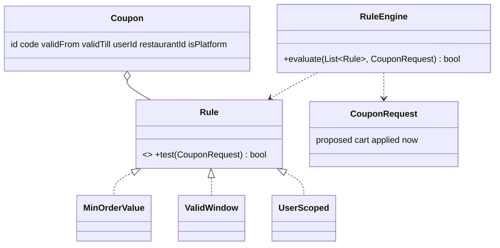

# Case study: coupon rule engine (food delivery checkout)

Use this when eligibility conditions are open-ended and authored by non-engineers: coupons, promotions, cashback, notification targeting, feature-flag targeting, risk checks, pricing surcharges. Anywhere product keeps adding "only if..." conditions. [L91]

## Problem and scope

On a Zomato-style checkout, show every coupon the user can apply (plus "potential" ones such as "spend 30 more"), apply one, handle clubbing, compute discount or cashback. The first model, a `Coupon` with fixed fields (restaurantId, userId, platform flag, validFrom, validTo, paymentMethod, code), breaks on the next condition: signed up over 3 years ago, cart contains biryani, 6 PM to 6 AM daily. Coupons arrive daily from many restaurants, so developers cannot hand-code each one. Second problem: if rules are opaque stored objects, how do you find which apply to this checkout? [L91]

The instructor gathered requirements by walking the real app's checkout in session and said doing that in an interview is fine. The class ran ~90 minutes; a real interview focuses on parts. [L91]

## Requirements

**Full:** list applicable and potential coupons, apply, club, discount (percent with cap, flat) or cashback, per-user usage limits and cooldowns, recurring time windows, scopes (user, restaurant, platform, payment method), admin authoring, validation of admin-entered rules. [L91]

**Shortlisted:** rule model and engine, apply endpoint with clubbing, list/discovery endpoint, per-user usage limit. Admin rule validation and OR logic acknowledged, not designed. [L91]

Separate validity checks (expiry, start, payment method, minimum order, scope) from discount computation. [L91]

## Entities and APIs

| Entity | Fields |
|---|---|
| `Coupon` | id, code, validFrom, validTill, userId?, restaurantId?, isPlatform, paymentMethod?, rules |
| `Cart` | userId, restaurant (via items), items, total |
| `CouponRequest` | proposed, cart, applied set, now |
| `CouponResponse` | applied set, deductedAmount, cashback |
| `Rule` | `boolean test(CouponRequest)` |
| `RuleEngine` | stateless evaluator |

```java
CouponResponse apply(Coupon proposed, Cart cart, Set<Coupon> applied);
List<Coupon> list(Cart cart);   // discovery, separate endpoint
```

Minimal, non-duplicated inputs: derive user and restaurant from the cart. [L91]



## Core algorithm and data structures

**Rule as a function object** (Specification/Strategy shape). A lambda or `Function` is an object, so a rule can be built, stored, passed and applied later. The engine never inspects rule internals; a new condition is a new class or JSON type tag and nothing else. [L91]

```java
interface Rule { boolean test(CouponRequest r); }
record MinOrderValue(long min) implements Rule {
  public boolean test(CouponRequest r) { return r.cart().total() >= min; } }
class RuleEngine {
  boolean evaluate(List<Rule> rules, CouponRequest req) {
    for (Rule rule : rules) if (!rule.test(req)) return false;   // AND only
    return true;
  }
}
```

The instructor's own demo of the same idea: a tic-tac-toe rule engine where row, column, diagonal and anti-diagonal checks are rules from board to game state, and a "board full means draw" rule was added with no engine change. Rules came from a provider standing in for a DB fetch. [L91]

**Persistence:** store `(couponId, ruleJson)`; on load, deserialize through a type registry (`{"type":"minOrder","value":500}` -> `MinOrderValue`, detail inferred). If your language cannot turn functions into data easily, you are writing a small parser from rule text to a predicate tree; budget for it. [L91]

**Apply flow:** load and deserialize the proposed coupon's rules, build the context, AND-evaluate; if valid, check clubbing against the applied set (keep clubbable ones, otherwise replace them; the proposed coupon is always in the result); compute deduction or cashback; GST on the post-discount amount. [L91]

**Discovery is an indexing problem, not a rule search.** Lift scope and validity into indexed columns (validFrom, validTill, userId nullable, restaurantId nullable, isPlatform, paymentMethod). Three targeted fetches (by user, by restaurant, platform-wide) within the current window, union, run the engine on candidates, rank, truncate. Every visible coupon is scoped to a user, a restaurant or the platform. About 15 user coupons means about 15 evaluations. [L91]

- Small active set: cache all currently valid coupons; otherwise index on validity and never load expired ones. [L91]
- Prefetch user and restaurant coupons while the cart is being built. [L91]
- Rank: user and restaurant first, then paid placement ("promote my coupon"), then a varied pick of platform coupons; filter by the user's payment methods; show top ~10. [L91]

## Concurrency

Not covered in class. Main failure (inferred): the same coupon applied twice by concurrent checkouts because the usage check and the order commit are not atomic. Fix with a unique constraint or conditional insert on the usage record at order commit and re-validate at payment. Cached rules must be invalidated on deactivation. [L91]

**Usage limits:** track per (coupon, user) in a usage table or the orders table, written after a successful order; a rule or pre-check reads it. The instructor moved from "mark the coupon used" to a per-user record once he saw a counter on a platform coupon cannot say who used it. A DB-reading rule complicates the engine; a check outside the engine is the alternative. Cooldowns are expressible as rules. [L91]

## Patterns used and rejected

| Option | Decision | Why |
|---|---|---|
| Rule objects + generic engine | Used | New conditions without touching engine or endpoint [L91] |
| Admin dashboard writing rules to a DB | Used | Scales with coupon volume; exposes only common building blocks [L91] |
| Developer-written "system coupons" | Kept, few | Bespoke promos (15-minute, one country, one dish) a dashboard cannot express; merged with admin coupons in output [L91] |
| Hard-coded if/else per coupon code | Rejected at scale | Engineering becomes marketing's bottleneck [L91] |
| Restaurant creates coupons by hand every evening | Rejected | Poor experience for the real customer of coupon creation [L91] |
| Hand-edited config file | Rejected | Tedious, slow to change and redeploy [L91] |
| Fixed fields per condition | Rejected | Breaks on the next condition [L91] |
| Query inside rule JSON for discovery | Rejected | Slow and awkward [L91] |
| Pre-generate every (user, coupon) pair | Rejected | Too many combinations; evaluate at runtime [L91] |
| Counter on the coupon | Rejected | Cannot enforce per-user limits [L91] |
| OR / nested logic | Deferred | Needs a composite rule tree (inferred) [L91] |

Unless conditions are few and stable, then plain fields are simpler (inferred). [L91]

## Tests

- Each Rule class in isolation, table-driven. [L91]
- Serialization round-trip for every rule type; unknown type fails closed. [L91]
- Engine unchanged when a new rule type is added (the draw-rule template). [L91]
- List endpoint against a fixture of user, restaurant, platform and expired coupons. [L91]
- Clubbing: merge vs replace, including the user losing a larger discount. [L91]
- Tax computed after discount; per-user limit enforced across two orders.

## Extensions and trade-offs

- **Code vs admin-configurable rules:** unlimited expressiveness vs cheap operation limited to building blocks; use both. A fully flexible dashboard becomes a programming language admins will not use. [L91]
- **Runtime evaluation vs precomputation:** small storage and fresh rules, affordable because metadata narrows candidates first. [L91]
- **Replace-on-conflict clubbing:** simple and matches the real app; the instructor calls it a poor experience but accepts it. [L91]
- **AND-only vs expression trees:** AND covers most coupons. [L91]
- Potential coupons ("spend X more") are a display requirement, not designed. [L91]

## Pitfalls the course hit

- Started with fixed fields; the pivot point to a rule engine is what the interviewer probes. [L91]
- Usage counter on the coupon, corrected to a per-user record. [L91]
- Validation of admin-entered rules raised by a student, left open. [L91]
- Forgetting the list endpoint is a common miss. [L91]

## What transfers to production

- Structure: `CouponRepository` (metadata queries), `RuleRepository`, `RuleRegistry` (type tag -> class), stateless `RuleEngine`, `DiscountCalculator` (percent with cap, flat, cashback to wallet), `ClubbingPolicy`, `UsageLedger` written at order commit. [L91]
- Rules are pure predicates over a context, or their side reads are explicit and kept out of hot loops. Version the rule schema. [L91]
- Reviewer check: metadata columns cannot drift from rules. A coupon restaurant-scoped in its rules but with null restaurantId never appears in the list. [L91]
- Watch timezone bugs in recurring windows and surprising discount stacks from clubbing (inferred). [L91]
