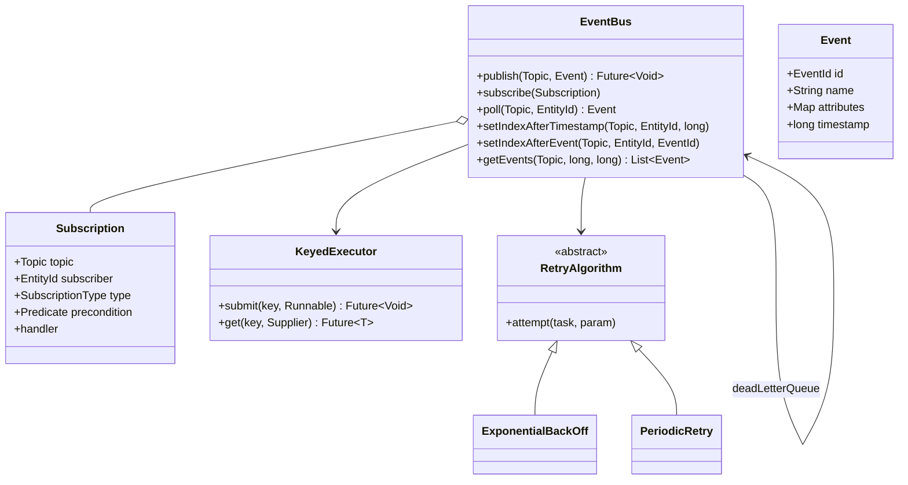

# Case study: event bus (machine coding)

Use this when building an in-process event bus, an outbox reader, a webhook dispatcher or any consumer that needs per-key ordering, push and pull delivery, retries with a dead-letter queue, and replay from an offset or a time [L60-L70].

## 1. Problem and scope
- A service publishes an event for each create, update and delete ("user registered"); subscribers such as an email service react. The publisher knows only the bus, never its subscribers [L60, L68].
- Many producers, many consumers. Consumers must filter cheaply, recover after a crash, onboard late, and survive poison messages [L61].
- Some domains break on reorder: credit 100 then debit 100 on a zero balance is fine; the reverse is illegal. Producer clocks drift, so timestamps cannot settle cross-producer order [L61].

## 2. Requirements (full -> shortlisted)
| Requirement | Decision |
|---|---|
| Topics; publish and subscribe | Core [L61] |
| Push and pull subscriptions | Core, both as configuration [L61, L66] |
| Per-topic ordering of writes across publishers | Core [L62] |
| Retry with backoff, then dead-letter queue | Core [L61, L64] |
| Replay from an event id or a timestamp | Core [L61, L67] |
| Events immutable; corrections are new events | Core [L61] |
| Subscription preconditions (filtering in the bus) | Built lightly [L66] |
| Idempotency by event id | Named [L61] |
| Range read `getEvents(topic, t1, t2)` | Built [L70] |

Pull by "the next event id" was rejected: a consumer cannot know a future id. Use offset (last seen) or timestamp [L61].

## 3. Entities and APIs

- `Entity{id, serviceName, ipAddress}` replaced separate Publisher and Subscriber types [L68].
- Typed wrappers (`Topic`, `EventId`, `EntityId`) replaced raw strings so swapped arguments stop compiling; acknowledged as maybe overkill [L68].
- One map of typed subscriptions, not twin push/pull maps; a subscription has its own id because one subscriber can hold several on a topic [L66].
- The DLQ is another `EventBus` passed in at construction; final failures publish a `FailureEvent{event, timestamp, exception}` [L68].
- `Timer` wraps the clock so tests control time [L64].

## 4. Core algorithm and data structures
| Structure | Shape | Purpose |
|---|---|---|
| Topic log | topic -> append-only list of events | publish appends at the end |
| Event index | EventId -> Event (or position) | O(1) fetch by id, replaced a linear scan [L68] |
| Timestamp index | topic -> `ConcurrentSkipListMap<ts, position>` | "first event after T", range reads [L67, L70] |
| Cursors | (topic, subscriber) -> position | pull position held by the bus [L67] |

- Seek by time uses `higherEntry(ts)`; with timestamps 3, 5, 6, 7, a range from 4 lands on 5 and scans forward [L67, L70].
- A hash map cannot answer "nearest" or range queries; a skip list is the sorted + concurrent map Java offers [L67, L70].
- Publish writes three structures (log, id index, time index) through one `addEventToBus`; then pushes to each push subscription through the retry wrapper [L68].
- Publish O(log N), poll O(1), seek O(log N) [L70].
- **Final cursor is a raw position.** The first version stored a timestamp or event id as the cursor and placed new subscribers at the tail, so they never saw new events; the conclusion switches to a positional index [L69, L70].
- The bus holds the cursor, so a client needs only topic plus its own identity and survives restarts [L67].

Retry [L64]:
```java
R attempt(Function<P, R> task, P param, int n) {
  try { return task.apply(param); }
  catch (RuntimeException e) {
    if (!(e instanceof RetryableException)) throw e;
    if (n >= maxAttempts) throw new RetryLimitExceededException(e);
    sleep(waitFor(n));                    // 2^(n-1) * 1000 ms, or fixed
    return attempt(task, param, n + 1);
  }
}
```
Retry only the consumer-declared retryable type; attempts and wait come from config [L64].

## 5. Concurrency
- One thread: ordered, slow. A plain pool: fast, unordered. One thread per user: millions of threads. Chosen: hash keys onto a fixed array of single-thread executors, the `KeyedExecutor`, in its own file, not inside the bus [L63, L65].
- **Writes keyed by topic**: all publishers' events on a topic are totally ordered, the stronger guarantee [L62].
- **Reads keyed by (subscriber, topic)**: a subscriber's pulls on one topic stay ordered, its other topics run in parallel. The first version keyed by subscriber alone and was refined [L62, L68].
- Pick the narrowest key the ordering requirement allows on each side [L62, L65].
- Keys sharing a slot become mutually ordered; accepted as the price of bounded threads [L63].
- Wall-clock timestamps, clock sync protocols and vector clocks were rejected for ordering: skew, or more machinery than needed [L61, L62].
- Concurrency was left until the logic was correct [L69].

## 6. Patterns used and rejected
- Strategy for retry (`ExponentialBackOff`, `PeriodicRetry`), Observer / pub-sub, Template for the retry loop (the course's subclasses still duplicate the loop body; hoist it (inferred)) [L64].
- Dependency injection of retry parameters and pool size from properties (Guice in the lesson); plain construction was called acceptable too [L64, L65].
- Rejected: mutable events with update/delete APIs [L61]; a mutable doubling wait factor (replaced by `2^(n-1)`) [L64]; thread class inside the bus [L65]; shard by topic for reads or by subscriber alone [L68]; `printStackTrace` after final failure (DLQ instead) [L68]; subscriber-side filtering [L66]; direct publisher-to-subscriber calls, fine only for one known consumer needing a synchronous answer (inferred) [L68].

## 7. Tests
- Flow from L69: publish to a topic with no subscribers; subscribe a pull subscriber; poll returns null; publish again; poll returns the new event [L69].
- Fixes it forced: `getOrDefault` on nested maps, index set at subscribe time, a sentinel for "no next entry" because a concurrent skip list cannot hold null [L69].
- Fix by auditing every nested structure, not one NPE at a time [L69].
- Worth adding (inferred from L62, L65, L70 notes): same-key events from several threads arrive in order; a slow handler on one key does not block another; force collisions with N=1; range query where neither end matches; seek before first and after last event; poll at end of log returns null; unknown event id gives an error, not an NPE.

## 8. Extensions and trade-offs
- Push gives immediacy; pull gives the consumer pace control and replay, at the cost of a cursor per subscription [L66].
- Server-held cursor: simpler, restart-safe client API; the bus stores per-subscriber state [L67].
- Extra indexes cost memory and writes but never need rewriting, because events are immutable [L70].
- Per-topic ordering gives up any order across topics [L70].
- A subscriber back after three days can jump forward with set-index APIs instead of draining the backlog [L70].

## 9. Pitfalls the course hit
- NPEs from nested maps that did not exist yet [L67, L68, L69].
- Callers writing `topics.get(x).add(...)` directly, skipping the other indexes [L68].
- Cursor in the wrong coordinate system (time or id instead of position) [L69].
- Linear scans for event by id or time on hot paths [L66, L67].
- Read APIs that move the cursor; range reads must be side-effect free [L70].

## 10. What transfers to production
- Per-key lanes: hash `(tenant, stream)` or `aggregateId` onto single-thread executors; this is Kafka's partition key in miniature (inferred analogy). Use `floorMod`; resizing the pool breaks ordering; any async hop inside a handler escapes the lane's order [L62, L65 notes].
- A blocking task stalls every key on its slot; keep slow pushes off the ordered thread [L65 notes].
- Duplicate timestamps overwrite in a ts -> position map: store the first with `putIfAbsent` or key by (ts, seq). Assign timestamps inside the bus on the topic's thread so they stay monotonic (inferred) [L70 notes].
- DLQ entries carry payload, time and error, with a replay path; a DLQ nobody drains is slower data loss (inferred) [L68 notes].
- Cap retries, classify exceptions, dedupe by event id, use compensating events instead of edits [L61, L64].
