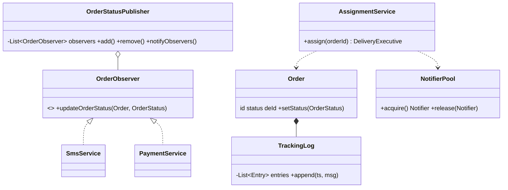

# Case study: food delivery partner assignment (Zomato mock interview)

Use this when assigning a job to one of several ranked workers (delivery, field service, ticket routing, ride matching), when a status change must fan out to several services, or when many callers share an expensive client. [L94]

Source note: the captions mostly capture the interviewer; the candidate's design is reconstructed from his restatements and closing feedback. [L94]

## Problem and scope

Order links User, Restaurant, Payment and DeliveryExecutive. Scope narrowed to the restaurant/delivery interaction with two APIs [L94]:

- `getStatus(orderId)`: callable by customer, system or executive; returns accepted, preparing, picked up, delivered.
- `assignDeliveryExecutive(orderId)`: not a setter. It must find, select and persist an executive. The interviewer corrected this explicitly.

Given helpers: a DB call returning the top 10 nearby executives for a restaurant sorted by time-to-reach, and a location-to-ETA API. Occupied executives (en route elsewhere) can be skipped. Ratings and support calls out of scope. [L94]

## Requirements

**Full:** place order, pay, restaurant accepts and prepares, assign executive, pick-up, delivery, status for all parties, notifications, cancellation with refund, ratings, support. [L94]

**Shortlisted:** assignment (discovery, offer, accept, persist), status with history, status fan-out, shared notification clients under concurrency. Ask what each helper returns and what the API owns before designing. [L94]

## Entities and APIs

| Entity | Notes |
|---|---|
| `Order` | id, userId, restaurantId, paymentId, deId, `OrderStatus` status, `TrackingLog` log |
| `OrderStatus` enum | PLACED, ACCEPTED, PREPARING, PICKED_UP, DELIVERED, CANCELLED |
| `TrackingLog` | append-only entries (timestamp, message) |
| `DeliveryExecutive` | id, occupied flag, location |
| `OrderObserver` | `updateOrderStatus(Order, OrderStatus)`; SmsService, PaymentService (refund on CANCELLED) |
| `NotifierPool` | bounded pool of notification clients |

Current status is an enum on the order; history is a separate append-only log. The delivery "process" is a log, not a second state machine; order status is the single source of truth. [L94]



## Core algorithm and data structures

**Sequential offer with timeout** [L94]:

```java
DeliveryExecutive assign(OrderId id) {
  Order order = repo.get(id);
  for (DeliveryExecutive de : geo.nearby(order.restaurantId(), 10)) {   // sorted by ETA
    if (de.isOccupied()) continue;
    notify(de, order);
    if (awaitAccept(de, order, Duration.ofSeconds(60))) {
      repo.saveAssignment(id, de.id());
      order.setStatus(EXECUTIVE_ASSIGNED); return de;
    }
  }
  throw new NoExecutiveAvailable(id);
}
```

- Worst case 10 x timeout per order, acceptable because it runs while food is cooked. Timeout of tens of seconds to a minute or two. [L94]
- Fail explicitly when no one accepts; real apps just say they could not find a partner. [L94]

**Sequential vs broadcast** [L94]:

| Workers | Strategy | Why |
|---|---|---|
| Dedicated employees expected to accept (Zomato) | Offer one at a time, timeout, next | Simple, no accept races |
| Third parties who may decline (Uber/Ola) | Broadcast, first accept wins | Latency and hit rate; must handle concurrent accepts |

**Assign late, not at order time.** Assignment is off the critical path (payment + recording the order). Run it asynchronously, triggered after the restaurant accepts, giving the system time to optimise. The interviewer conceded his earlier "you need it right now" was wrong. [L94]

## Concurrency

- Keep concurrency out of the core flow where the business allows: each order's assignment loop stays sequential; different orders (Delhi, Chennai) run in parallel (inferred from the exchange). [L94]
- **Many callers, one expensive resource** (DB connection, SMS/email client) is a pooling problem. The expected answer was an object/resource pool with reuse and a cap, not semaphores, and not a plain FIFO queue, since work must run in parallel. [L94]

```java
class NotifierPool {
  private final BlockingQueue<Notifier> idle; private final int max; private int created;
  synchronized Notifier tryCreate() {
    if (created >= max) return null; created++; return factory.create();
  }
  Notifier acquire() throws InterruptedException {
    Notifier n = idle.poll(); if (n == null) n = tryCreate();
    return n != null ? n : idle.take();
  }
  void release(Notifier n) { idle.offer(n); }
}
```

- If anything else can assign concurrently, `saveAssignment` must be conditional (`UPDATE ... WHERE de_id IS NULL`) (inferred). [L94]

## Patterns used and rejected

| Choice | Decision | Why |
|---|---|---|
| Observer for status fan-out | Used | New consumer (payment, interested only in CANCELLED) implements the interface; order code unchanged [L94] |
| In-process pub/sub queue instead | Acceptable | Same decoupling inside one service [L94] |
| Subject observing itself | Rejected | The owner already knows; observers are for outside parties [L94] |
| Object/resource pool | Used | Creating clients per request is costly; count must be capped [L94] |
| Semaphore or single FIFO queue for the shared notifier | Rejected | Not the expected answer; work must run in parallel [L94] |
| Broadcast to all executives | Rejected for employees; right for gig marketplaces [L94] |
| Assign at order time | Rejected | Not critical; defer and optimise [L94] |
| Delivery process as its own stateful class | Rejected | Folded into a log [L94] |
| Smarter dispatch (executive finishing a nearby drop, arrival timed to food-ready, batching nearby orders) | Parked | Better, too complex for the time box [L94] |

## Tests

- Fake geo service with a fixed ranked list; fake clock for timeouts. [L94]
- Decline or timeout falls through to the next candidate; occupied executives skipped. [L94]
- All decline: explicit failure. [L94]
- Each observer fires once per transition; payment refunds only on CANCELLED. [L94]
- Every status change appends one log entry.
- Pool never exceeds its cap under parallel assignment.

## Extensions and trade-offs

- **Sequential vs parallel offering within an order:** simplicity and no races vs slower assignment. [L94]
- **Early vs late assignment:** certainty vs a better choice and event-driven decoupling. [L94]
- **Observer vs hard-coded calls:** an interface and registration step vs zero change to order code when consumers are added. [L94]
- **Depth vs breadth in 45 minutes:** product decisions and patterns covered; code and testing thin, marked down even though time-driven. [L94]

## Pitfalls the course hit

- Treating `assignX(id)` as a setter taking the chosen object. [L94]
- Two state machines (order status and delivery process) moving together. [L94]
- Not enough code and no testing discussion; plan time for the core loop and a test plan. [L94]
- Outcome: between hire and strong hire; product sense (sequential, late assignment) was the strongest positive. [L94]

## What transfers to production

- Dispatch: rank via geo/ETA, offer sequentially with a timeout, persist with a conditional update so retries or a second worker cannot double-assign; per-order work on a worker pool (inferred). [L94]
- Trigger assignment from an "order accepted" event, not inside checkout. [L94]
- Status enum plus an append-only `order_events` table written in the same transaction (inferred). [L94]
- Across services Observer becomes outbox + broker; in-process, isolate observers so one slow or throwing consumer cannot block the rest (inferred). [L94]
- Pools: size limits, acquisition timeouts, and returning objects on error paths are the usual failure points. [L94]
