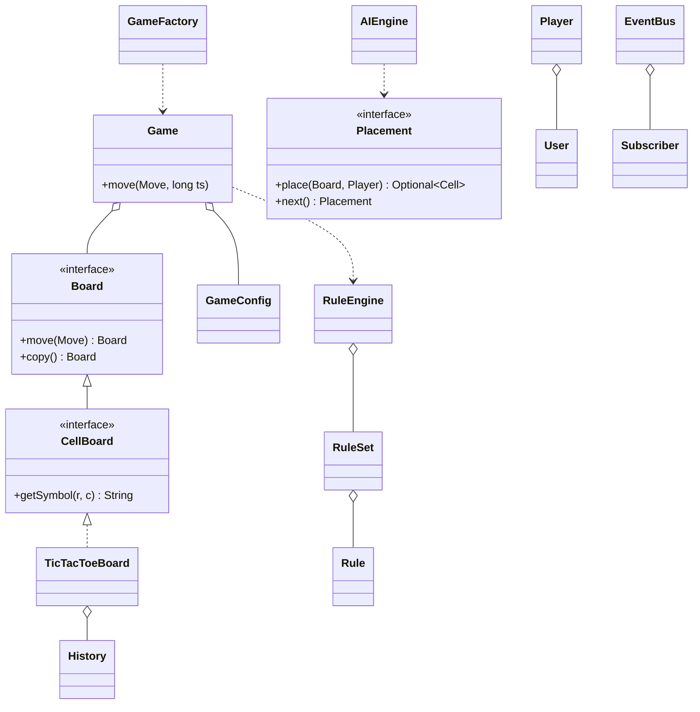

# Case study: turn-based game engine (refactor story)

Use this when a codebase is growing by feature requests and you need to see which principle or pattern each kind of change request should trigger, or when you need a reference shape for a game/rule/AI engine. The course builds tic-tac-toe badly on purpose, then lets each new requirement force one change [L0-L41].

Contents: 1 Problem | 2 Requirements | 3 Final classes | 4 Core algorithm and change log (request -> trigger) | 5 Concurrency | 6 Patterns used and rejected | 7 Tests | 8 Extensions and trade-offs | 9 Pitfalls | 10 Production

## 1. Problem and scope
- Brief: an engine that can play any turn-based board game; tic-tac-toe is the first game. Requirements are vague on purpose [L2, L3].
- Code is judged on readability, extensibility and correctness, and quality shows up as how cheap the next change is, not how good day one looks [L1, L0].
- Method: write it naively (one file, `instanceof` branches, copy-pasted row/column/diagonal loops), make it correct, then refactor only when a real request hurts [L3, L7, L14].

## 2. Requirements (full -> shortlisted)
| Arrived as | Request |
|---|---|
| Day 1 | start game, make move, is it over and who won (draw vs in progress) [L3] |
| L11 | AI that wins when it can and blocks when it must |
| L17 | report forks; later, moves per player [L17, L19] |
| L21 | timed games: per-move limit and/or total time per player |
| L24 | multiple AI personalities (fast, smart, optimal) |
| L29 | move history and undo |
| L39 | email on win, "welcome back" after 10 days away; then SMS too [L39, L40] |

The shortlist is always "the current request plus keep the tests green". Nothing is built ahead of demand [L14].

## 3. Entities and APIs (final shape)

- Split by kind of knowledge: `GameEngine` runs moves, `RuleEngine` says legal / over / winner, `AIEngine` suggests a move [L8, L10].
- `Board` is an interface (only `copy`, `move`); `CellBoard` adds `getSymbol` for grid games [L13, L27].
- `Player{user, symbol, timeUsed}` is a per-game role; `User{id}` is identity; `Game` owns `lastMoveTime` [L22].
- `GameInfo` (isOver, winner, hasFork, forkCell, numberOfMoves) is built through `GameInfoBuilder` [L19, L24].
- `Cell` is immutable and pooled (flyweight-style), created through a static `getCell(r, c)` [L35].
- Notifications: `EmailCommand` / `SmsCommand` each hold a `NotificationDetails`; game code calls `eventBus.publish(Event)` [L41].

## 4. Core algorithm, data structures, and the change log
- Game state: the rule engine looks up the board's `RuleSet`, runs each `Rule` (row, column, diagonal, anti-diagonal, full board) and returns the first decisive `GameState`; each rule is one `findStreak(traversal)`, so a 3x3 check is a few dozen reads [L16, L18].
- AI: the placement chain stops at the first handler that returns a cell; offense and defense each try every empty cell on a board copy, O(cells) copies per move [L13, L26].
- Fork: for each empty cell, play it, ask the defensive placement whether the opponent must block, play the block, ask the offensive placement whether you still win: two plies on copies [L17, L31].
- History: `List` of snapshots; jumping back to move k truncates later entries before the next move [L29].
- The O(1) running-sum check is in `tic-tac-toe.md` [L93].

Change log, request -> what it triggered:
| Pain / request | Trigger | Change made |
|---|---|---|
| Everything in one file; engine reads `board.cells` | Packages + encapsulation | One class per file, packages `api/game/boards`; getters, `getCell` on the concrete board only [L4, L5] |
| God `GameEngine` | SRP | Split into GameEngine / RuleEngine / AIEngine; board applies its own moves [L8] |
| Smarter AI | OCP intro | Keep one `suggestMove`; pick basic vs smart internally by a named threshold, no second public method [L11] |
| AI trial moves corrupt the live board | Prototype | `board.copy()` per trial [L12, L13] |
| 90-line `getState` with twin loops | DRY | One `findStreak(traversal)` driven by lambdas [L14-L16] |
| Find forks, then move counts | OCP | `getState` if-chain -> `Rule` objects in a `RuleSet` keyed by board type [L17, L18, L23] |
| Optional fields piling into `GameInfo` | Builder | Delete telescoping constructors [L19] |
| Timers | LSP / composition | One `Game` composing `GameConfig`; no `TimedGame` subclass [L21, L22] |
| Rules need `getSymbol` but not all boards have cells | ISP + DIP | `CellBoard` sub-interface; rules depend on it, not on `TicTacToeBoard` [L27, L28] |
| Ordered AI heuristics (win, block, fork, centre, corner) | Chain of Responsibility + Singleton | One `Placement` class per heuristic with explicit `next()`; `Optional<Cell>` results [L24-L26] |
| Undo | Memento | `History` list of snapshots owned by the board; `move` copies and records [L29] |
| History memory | Proxy -> compact representation | Store a string form; rebuild a board via a constructor [L30] |
| Five nested loops in fork detection | Reuse domain objects | Fork = "after my move, opponent must block, and I can still win", using the existing placements [L31] |
| Nested if on game phase | State tried, rejected | Kept the branch; see section 6 [L32] |
| Six-arg `Game` constructor in tests | Factory | `GameFactory.createGame(maxPerMove, maxPerPlayer)` plus overloads with defaults [L34, L35] |
| Growing `sendEmail(...)` | Command + Builder | `execute(command)`; business rules (links, templates) in the builder [L39] |
| SMS added, base builder returns base type | Composition over inheritance | `NotificationDetails` composed into each command [L40, L41] |
| Gameplay calling every channel | Pub-sub | `EventBus.publish`, channels subscribe [L41] |

## 5. Concurrency
- Copy-then-discard was chosen over make/undo on one board partly because a shared mutable board is unsafe under a parallel AI search [L12, L13].
- Otherwise the engine is single-threaded; the course does not add locks here. A real multi-request game would serialise moves per game id (inferred).

## 6. Patterns used and rejected
| Pattern | Verdict | Why / flips when |
|---|---|---|
| Iterator for line scans | Rejected | Carries one variable; a 2-D walk needs two iterators. Use it for one sequence or irregular walks you want hidden [L15] |
| Wrapper "onion" (`GameInfo` around `GameState`) | Rejected as default | Every next request adds a layer [L17, L20] |
| Rule engine for timing variants | Rejected | Timing checks are order- and config-dependent; rule sets fit independent checks [L22] |
| Rule set for AI heuristics | Rejected | No inherent order; the chain makes order explicit [L24, L26] |
| `getSymbol` on base `Board` | Rejected | LSP break for chess, hex or 3-D boards [L23, L27] |
| Downcast in rules | Rejected | No compile-time guarantee [L23] |
| Proxy that implements `Board` | Rejected here | Must delegate everything and memory grows back; right for heavy resources like DB connections [L30] |
| State pattern for AI phase | Rejected after partial build | No real transitions, near-infinite states, `next()` would copy the whole condition into every state. Right for finite phases with sparse event-driven transitions [L32] |
| Strategy for AI phase | Poor fit | Programmer, not input, would pick it. Right when config or user picks (difficulty level) [L32] |
| `switch` instead of if/else | Rejected | Same coupling, new syntax [L32] |
| Builder for `Game` | Rejected | Problem was creation logic and defaults, so Factory [L34] |
| Abstract base command + builder | Rejected | `build()` can only return the base type; casts and `buildEmail()` are the bad fixes [L40] |
| Abstract `Event` subclasses | Flattened | One `Event` with a `type` field was enough [L41] |

## 7. Tests
- First suites scripted human moves against the live AI; they broke as soon as the AI changed. Rewrite with explicit `firstPlayerMoves` / `secondPlayerMoves`, so rule tests never depend on a heuristic [L9, L10, L13].
- Do not "fix" a failing test by editing expectations to match new logic [L13].
- Timed tests: pass timestamps explicitly (base 5000), never the system clock; pick budgets like 11 s so the deciding move clearly overflows rather than sitting on a `<` vs `<=` boundary [L35, L36].
- Scenarios from L37: both limits broken; per-player only; fast win within budget (exposed the missing win check); one slow move with no per-move limit means no winner.
- Write a test to give an unused class a caller before refactoring it [L33].

## 8. Extensions and trade-offs
- Mechanical DRY cut 90 lines to 60 but read worse; the instructor kept it because the logic was single-sourced, after renaming [L14, L16].
- Rule returns `GameState`, not boolean, so games where the winner is not the last mover still fit [L18].
- Rules in config/DB were the next flexibility step, not taken [L18].
- Undo by inverse works for tic-tac-toe; snapshots generalise to cascading games [L29].
- Cell pool is a fixed 3x3 array: known debt for bigger boards [L35].
- Singletons were hand-written for teaching; real code should use DI [L25, L26].

## 9. Pitfalls the course hit
- NPE on null first cell; an empty diagonal reported as a win; a completed column not ending the game [L7].
- `setCell` allowed overwrites, which hid AI bugs; adding the guard broke every scripted test [L13].
- Opponent's winning move reused with the opponent's symbol instead of re-issued as your own [L12].
- Timed tests: cells never initialised, winner compared by reference, moves still applied after a winner existed [L36].
- Dependent time checks run as separate branches; board copy not reassigned; no post-move win check; factory filled a per-move limit that should be null; `int` vs `Integer` unboxing [L34, L37].
- Do not make `set` idempotent to silence a double move; it hides the real bug [L37].

## 10. What transfers to production
- Hard-coded `if (cond) return` chains in validators, pricing or eligibility are rule engines waiting to be extracted: rule list keyed by type, rich result [L18].
- Speculative evaluation (pricing previews, schedulers, solvers) runs on copies; review every `copy()` field by field and test that mutating the copy leaves the original unchanged [L13].
- Ordered fallbacks (resolvers, auth providers, placement heuristics) fit Chain of Responsibility; unordered independent checks fit a rule set [L24, L26].
- Put the widest abstraction that still has what a collaborator needs in its signature (`CellBoard`, not `TicTacToeBoard`) [L28].
- New per-feature state goes into a composed config, not a subclass per variant [L21].
- Creation logic and defaults belong in a factory; tests pass only what they care about [L34, L35].
- Callers of a growing service send a command object; producers that call many consumers should publish an event [L39, L41].
