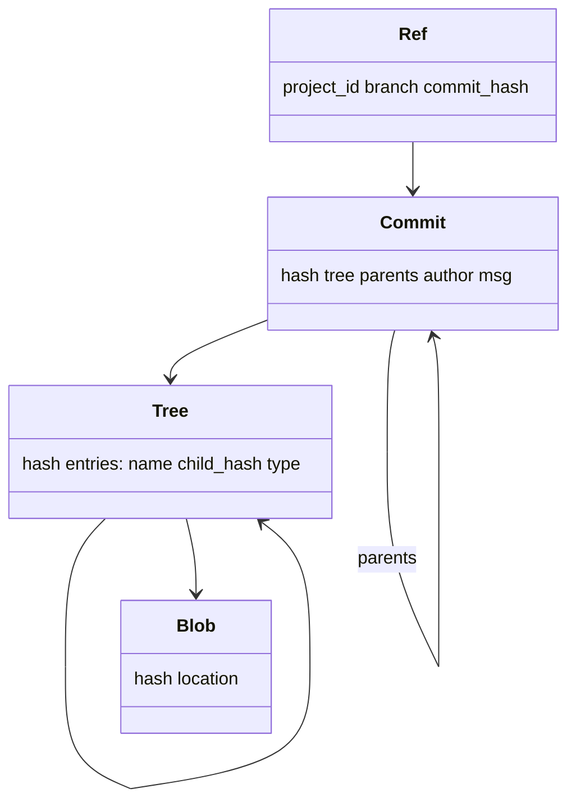

# Case study: database schema design (GitHub, Git storage, ACLs)

Use this when asked to "design the DB schema for X", when a column holds a list, when per-resource permissions are needed, or when storing versioned content or a hierarchy. Senior and manager loops ask this after system design (GitHub, BookMyShow with no double booking, Twitter feed, per a student). [L92]

## Problem and scope

Store GitHub's repos, PRs, review comments, file history and permissions. Three smells drove the design [L92]:

- An `organization` row with comma-packed `admins` and `members` columns: to check one admin you read everyone, membership cannot be indexed, every change rewrites the row, and the caller sees other members (data exposure).
- Permissions finer than roles ("member, but write only on the server repo"). Roles in code or config do not scale to thousands of projects edited constantly.
- A directory tree as parent -> children rows: a 7-level Java project costs 7 sequential queries or self-joins. It works but will not pass a review.

**Method:** product features from the user's view -> APIs and their objects -> tables. "What to store" comes from the product; "how to store it" comes from access patterns, the actual queries. Flips when tuning an existing schema, where the DBA view comes first. [L92]

## Requirements

**Full:** users, orgs, membership, repos, branches, commits, file history, PRs, reviewers, review comments, diffs, permissions, temporary admin elevation. [L92]

**Shortlisted:** membership, authorization, repo storage (blobs, trees, commits, branches). User profile details set aside as standard; PRs and comments listed, not modelled. Scope early when time is short. [L92]

## Entities and APIs

```sql
user(id, email, two_fa_phone, ...)
org_member(org_id, user_id, role)            -- ADMIN | MEMBER | GUEST
  INDEX (org_id, user_id)                    -- "is PQR in this org?"
acl(subject, relation, object)               -- ("user:g","editor","repo:ir/server")
  INDEX (subject, object) or (object, relation)   -- by dominant question
object(hash PK, type, location_or_bytes)     -- BLOB | TREE | COMMIT
ref(project_id, branch, commit_hash)
```



**Membership:** one row per (entity, member[, type]). Membership checks become index seeks, adding is an insert, and you never load others' data. If one subset (admins) is large and queried alone, use a separate table or a composite index led by type (inferred), since a query generally uses one index; cost is a join for "all members". [L92]

**Authorization as data:** tuples `(subject, relation, object)` survive restarts, change constantly and number in the thousands. Index by subject ("what can this user access?") or object ("who can access this repo?"). Google Zanzibar is the general form (subjects can be usersets such as `org:ir#admin`, checks expand recursively); the instructor preferred a flat user-to-object ACL for GitHub. Start flat; add inheritance only when teams are a real requirement. Authentication and authorization are separate. [L92]

**Temporary elevation:** a signed, time-bounded token carrying the claims, verified with no DB hit, instead of an opaque id that needs a lookup. In practice an asymmetric JWT (inferred). Revocation is harder (inferred). [L92]

## Core algorithm and data structures

**Content-addressed objects (Git model)** [L92]:

- Each blob is keyed by its content hash; bytes in object storage (S3) with a hash -> location row. Identical content dedupes. If the interviewer says RDBMS only, bytes go in a blob column of the same table.
- Directories are immutable tree objects listing children's hashes. A change creates new nodes only along the path from the file to the root (persistent data structure). Unchanged subtrees are shared.
- Branches are a ref table `(project, branch) -> commit`, commit -> root tree. Switching branches just follows another root. History is a DAG (branches, merges).

Worked tree: A{B,C,D}. Edit B -> A'{B',C,D}. Edit D -> A''{B',C,D'}. Six nodes coexist; C is shared throughout. [L92]

```java
Hash write(Path p, byte[] content, Hash rootHash) {       // copy-on-write along the path
  if (p.isLeaf()) return store.put(Blob.of(content));      // hash = sha(content)
  Tree t = store.getTree(rootHash);
  Hash child = write(p.rest(), content, t.child(p.head()));
  return store.put(t.withChild(p.head(), child));          // new node, siblings shared
}
```

**Read path:** ref -> commit -> root tree -> child hashes -> fetch -> repeat. Cost is depth x queries. The class left this open; the instructor's move was to ask which reads need the whole tree. Clone is rare and can be one bulk or packed transfer; diffs, commits and opening a few files touch few nodes. Since objects are immutable, cache by hash forever (inferred). [L92]

**Diffs:** an LCS-style problem; the instructor called algorithm detail unnecessary here. [L92]

## Concurrency

Not covered. Immutability helps: objects never change, so concurrent readers need no locks and caches never go stale (inferred). The only mutable row is the ref; updating a branch should be a compare-and-set on the old commit hash so two pushes cannot silently overwrite each other (inferred). [L92]

## Patterns used and rejected

| Option | Decision | Why |
|---|---|---|
| Junction table for membership | Used | Indexable, insert not rewrite, no exposure [L92] |
| Packed list column | Rejected | Only if you always read the whole set [L92] |
| Permissions in config | Rejected | Thousands of projects, constant edits, must survive crashes [L92] |
| Full Zanzibar | Rejected for GitHub | Overkill; flat ACL preferred [L92] |
| File versions as JSON in a row | Rejected | Hash-keyed objects instead [L92] |
| Explicit directory table (parent/children rows) | Rejected | Children live inside the tree object [L92] |
| Store diffs instead of snapshots | Rejected | Snapshots keep reads simple; deltas computed later in packfiles [L92] |
| Normalisation level | 2NF in practice | 3NF is usually the most anyone goes; NoSQL often skips it [L92] |

## Tests

- For each listed access pattern, write the query and check `EXPLAIN` uses the intended index. [L92]
- Signed token: expiry, clock skew, tamper. [L92]
- Editing one file creates exactly depth + 1 new objects and shares the rest.
- Same content under two paths stores one blob.
- ACL: editor on one repo has no access to a sibling repo (the worked example). [L92]

## Extensions and trade-offs

- **One membership table vs split:** faster subset queries vs a join for "all members"; choose by dominant query. [L92]
- **Copy-on-write trees vs in-place:** extra writes per commit for simple reads and shared versions; file systems are read-heavy. [L92]
- **Space:** a full file per change wastes space locally; packfiles (delta compression) and GC handle it on transfer. Git does not understand content; any change makes a new hash. [L92]
- **Hot whole-subtree reads in an RDBMS:** recursive CTE, materialized path or closure table (inferred, not covered). [L92]
- **Warm-up aside:** large calls use a nearby media server (O(n) connections) instead of a mesh (O(n^2)), which overloads uplinks and loses quality control; signalling (SIP/SDP) is separate from the media plane. [L92]

## Pitfalls the course hit

- The session drifted because the problem was taken live without pinned requirements; the instructor committed to preparing problems in advance. Pin requirements first. [L92]
- The N-queries-per-depth read was left unresolved. [L92]
- Students went deep on diff algorithms nobody asked about. [L92]

## What transfers to production

- Multi-tenant SaaS: `membership(tenant_id, user_id, role)`, PK `(tenant_id, user_id)`, secondary index on `user_id` for "my orgs". Reviewers flag array or JSON membership columns. [L92]
- Authorization service: tuple table indexed both ways if both questions are hot; cache checks carefully, invalidation is the hard part (inferred). [L92]
- Versioned documents, config history, ML artifacts, build caches: content-addressed blobs plus immutable manifests; plan GC for orphaned blobs and use SHA-256 (inferred). [L92]
- Before writing a recursive fetch, list the real queries. [L92]
