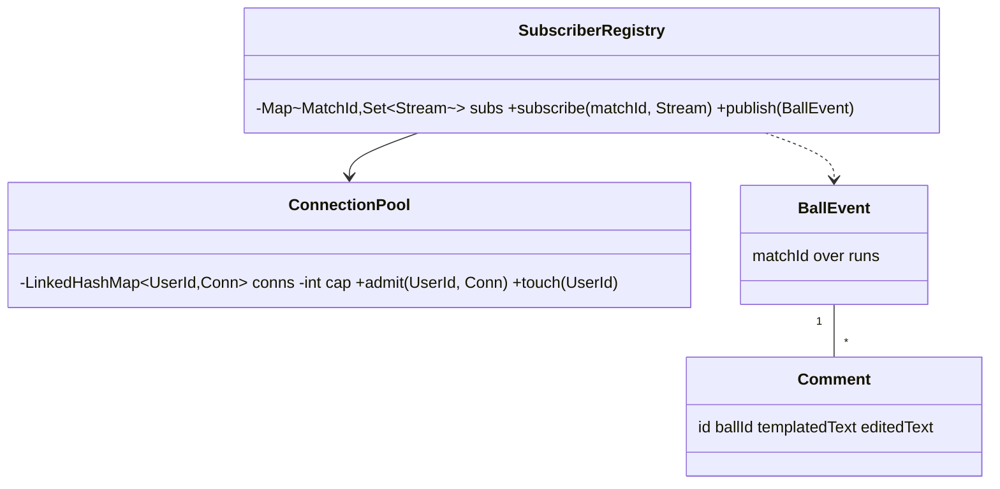

# Case study: live score updates (polling, SSE, WebSockets, connection pools)

Use this when a component must push updates to many clients (scores, tickers, order status, build logs, feeds), and you must pick a delivery mechanism and decide what happens at the per-box connection ceiling or on deploy. [L88]

## Problem and scope

A Cricbuzz-like app scoped to one component: when an admin enters a ball event (score plus a templated comment that a commentator may edit 30 s to 2 min later), broadcast it to every interested user in real time. Two user types: those with the match tab open, and API callers. Constraints raised: weak connectivity in parts of India, a finite number of connections per server, and millions of clients reconnecting at once. [L88]

The first ~40% of the class was unrelated Q&A; useful asides are under Extensions. [L88]

## Requirements

**Full:** admin enters ball events; auto-generate placeholder comment; human edits comment; broadcast score and edits; serve tab users and API users; profiles, sessions, admin input UX, player and team rosters. [L88]

**Shortlisted:** one-way broadcast of ball events and comment edits to subscribers of a match, bounded connections per box, reconnect behaviour. Rosters, profiles and admin UX out of scope. SDE1/2 get "design Cricbuzz"; seniors get "design the real-time notification component". [L88]

## Entities and APIs

| Entity | Fields |
|---|---|
| `Match` | id, type, startTime, teams |
| `BallEvent` | matchId, over.ball (e.g. 19.1), runs |
| `Comment` | id, ballId, templatedText, editedText (an edit is itself an event) |
| `ConnectionPool` | capacity, LRU map userId -> connection |
| `SubscriberRegistry` | matchId -> set of streams |

APIs: `GET /match/{id}/events?after=lastBallId` (long poll fallback), `GET /match/{id}/stream` (SSE), admin `POST /match/{id}/ball`. [L88]



## Core algorithm and data structures

**Protocol picker** [L88]:

| Mechanism | How | Use when |
|---|---|---|
| Short polling | Timer GET, server answers at once | Rejected here; no benefit over long polling for frequent updates. Fine for rare updates or infra that cannot hold requests (inferred) |
| Long polling | Server holds the request until an event or timeout; client re-requests at once | Fallback when push is not possible |
| SSE | One HTTP request, server streams `text/event-stream` chunks | Server -> client only. Chosen for scores |
| WebSocket | Full duplex after HTTP upgrade | Client must send unsolicited messages (chat, collaborative editing) |

Pick by direction of communication, not by the word "real time". Connection TTL/keep-alive is separate from polling style: TTL is connection lifetime; short vs long is whether the server answers immediately or waits. [L88]

**SSE fan-out:**

```java
void onSubscribe(MatchId m, Stream s) { registry.computeIfAbsent(m, k -> newSet()).add(s); }
void onBallEvent(BallEvent e) {
  for (Stream s : registry.get(e.matchId())) s.write("data: " + json(e) + "\n\n");
}
```

**Connection pool as a cache with LRU eviction**, O(1) per operation. Every request or delivery is the activity signal; no separate "I am active" ping is needed. [L88]

```java
class ConnectionPool {
  LinkedHashMap<UserId, Conn> conns = new LinkedHashMap<>(16, 0.75f, true); int cap;
  void touch(UserId u) { conns.get(u); }
  void admit(UserId u, Conn c) {
    if (conns.size() == cap) { var e = conns.entrySet().iterator().next();
      e.getValue().sendClose(); conns.remove(e.getKey()); }
    conns.put(u, c);
  }
}
```

**Capacity:** bound by memory per connection and auxiliary structures, not "64K ports". Many clients share one listening port; the instructor has seen hundreds of thousands per box, and a million with heavy tuning. [L88]

## Concurrency

- Registry and pool are touched by the admin publisher and many connection threads; use concurrent sets or a lock per match (inferred).
- Eviction must send an explicit close so the client reconnects deliberately; otherwise it cannot tell a quiet match from a dead connection. Client rule: reconnect on close, or after a silence timeout. [L88]
- Thrashing (evict A for B, A returns, evict B for A) means all work is connection churn; scale out. [L88]

## Patterns used and rejected

| Choice | Decision | Why |
|---|---|---|
| Push by default, pull as forced fallback | Used | The product's value is how fast you reach many users [L88] |
| LRU eviction of individual connections | Used | Recently active users care about this match [L88] |
| WebSockets for scores | Rejected | Two-way not needed [L88] |
| Short polling | Rejected | A student argued it helps weak networks and avoids held connections; acknowledged pull reduces herd risk, but push chosen [L88] |
| Periodic drop of all connections | Rejected | Thundering herd, memory spike, broken UX; you pay for the box anyway, so keep it full [L88] |
| Hybrid short poll + periodic drop + queueing | Rejected | Dropping is never needed if you evict the lowest priority [L88] |
| Redis pub/sub | Usable | It too has connection limits [L88] |
| Shard subscribers by match/country (consistent hashing) | Accepted | Orthogonal to protocol choice [L88] |

## Tests

- At the cap, LRU order of eviction is correct and the evicted client receives a close. [L88]
- Kill a gateway and measure the reconnect spike. [L88]
- Soak test with many idle connections to measure memory per connection. [L88]
- Comment edit after a ball event reaches all current subscribers.
- Reconnect with `after=lastId` gets no gaps and no duplicates (inferred).

## Extensions and trade-offs

- **Push vs pull:** latency and product value vs fewer load spikes and better fit for weak networks. [L88]
- **Memory vs latency at the ceiling:** eviction saves memory but adds reconnect latency, then becomes thrashing. The only two options left are worse UX or more hardware; a business earning per user picks hardware. [L88]
- **Deploys:** split connection gateways (hold sockets, rarely redeploy) from business logic and connection metadata, or every feature deploy drops all connections and causes a reconnect storm (from the instructor's video-calling experience). [L88]
- **Biggest latency:** the human at the ground typing the event, not the network. [L88]
- **Asides from pre-class Q&A** [L88]: a counter with 10K writes/s should count in memory and flush periodically rather than hit MySQL per increment; use a queue (RabbitMQ/Kafka) to separate distribution from the producer; PKI authentication needs a signature with the sender's private key, not just encryption with the receiver's public key.

## Pitfalls the course hit

- Defaulting to WebSockets because "real time". [L88]
- A student conflated TTL with long polling. [L88]
- A student claimed a 64K connection limit. [L88]
- Proposals to drop everyone every N seconds. [L88]

## What transfers to production

- SSE endpoint per topic, in-process registry topicId -> streams, fed by a pub/sub bus; shard subscribers so one node owns a topic. [L88]
- Gateway tier that rarely deploys; drain connections and jitter client reconnects on deploy (inferred). [L88]
- Clients resume with `Last-Event-ID` or `after=lastId`, with exponential backoff and jitter (inferred). [L88]
- Alert on active connections, eviction rate and reconnect rate; autoscale on connection count rather than CPU (inferred). [L88]
- Reviewer checks: does the client ever send unsolicited messages (if not, why WebSocket)? What happens at the cap? What happens on deploy? Can a client resume from its last event?
