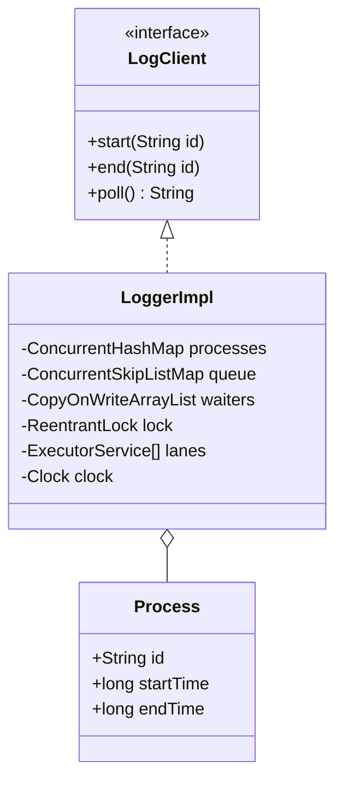

# Case study: ordered process logger (Google question)

Use this when results finish out of order but must be emitted in start order (job runners, CI step logs, resequencing async responses, start-ordered audit logs), when one object keeps two indexes over the same data, or when a read API must block until another call produces data [L83, L84].

## 1. Problem and scope
- API: `start(id)`, `end(id)`, `poll()`. `poll` emits "<id> started at <start> and ended at <end>" for the earliest-started process, and only once that process has ended [L83].
- Example: P1 starts at 12, P2 at 8, P3 at 7; P3 ends at 19, P2 at 12, P1 at 15. Output order is P3, P2, P1. P2 finished first but waits behind P3 [L83].
- Part 1 builds the data structure single-threaded and returns a message when nothing is ready. Part 2 makes `poll` block and makes the class thread-safe [L83, L84].
- A short round usually goes deep on either the algorithm or concurrency and tests; mention both [L83].

## 2. Requirements (full -> shortlisted)
| Requirement | Decision |
|---|---|
| start, end, poll with the output format | Core [L83] |
| Emit in start order; finished processes wait behind older running ones | Core [L83] |
| Every operation O(log n) or better | Core [L83] |
| `poll` blocks until the head finishes, with a timeout | Part 2 [L84] |
| Thread-safe under concurrent start / end / poll | Part 2 [L84] |
| `end` arriving before `start` | Client contract assumed; buffering named as the realistic answer [L84] |
| Injectable clock | Core for testability [L83] |

## 3. Entities and APIs

- `endTime` starts at -1. Defaulting to 0 printed "ended at 0" live [L83].
- `poll` returns a string in Part 2 so tests can assert on it instead of eyeballing output [L83, L84].
- The clock is injected and read once per event, so both indexes get the same timestamp [L83].

## 4. Core algorithm and data structures
| Structure alone | start | end | poll | Verdict |
|---|---|---|---|---|
| List | O(1) | O(n) search | O(n) | Rejected |
| HashMap | O(1) | O(1) | O(n), no order | Rejected |
| Heap | O(log n) | O(n), no lookup by id | O(log n) | Rejected alone |
| TreeMap by id | | | wrong order | Rejected (a student caught it) |
| **HashMap id -> Process + sorted map start -> Process** | O(log n) | O(1) | O(log n) | Chosen [L83] |

```java
void start(String id) {
  Process p = new Process(id, clock.now());
  byId.put(id, p); byStart.put(p.startTime, p);
}
void end(String id) { byId.get(id).endTime = clock.now(); }   // queue sees it via the shared reference
String pollNow() {
  Process head = byStart.firstEntry().getValue();
  byStart.pollFirstEntry(); byId.remove(head.id);
  return format(head);
}
```
- `end` does not touch the sorted structure: both indexes hold the same object and `endTime` is not the sort key. A live chat poll split 50/50 on this [L83]. If the mutated field were the sort key, remove and re-insert (inferred).
- TreeMap is a red-black tree, O(log n), not O(1). A heap plus map is equivalent and lighter; TreeMap was just more convenient [L83].
- Two processes starting in the same millisecond overwrite each other in a map keyed by start time alone; use (start, id) or a heap with a tie-break (inferred) [L83].
- `poll` order: check empty, then check the head has ended, then emit and remove from both structures. Each step was a live bug [L83].

## 5. Concurrency
Four problems [L84]:
1. `poll` returned null instead of blocking.
2. `end` running before `start`'s put lands: NPE, the end is lost, the entry leaks, and `poll` blocks forever behind it.
3. `poll` and `end` both mutate the head across two structures; each structure is thread-safe, the pair is not.
4. A lock on `end` gives exclusivity, not order: `start` for the same id can still be mid-flight.

Fixes [L84]:
- **Blocking poll via futures.** `poll` takes the lock; if the head has ended it emits, otherwise it registers a `CompletableFuture` in `waiters` and waits with a 3 s timeout. `end`, under the same lock, completes the first waiter when it finishes the head. The producer knows when the condition becomes true, so no busy-wait or `Thread.yield` [L84].
- Return the future instead of blocking when the caller is in-process; block only because the result crosses an API [L84].
- **Lock by CRUD.** Create (`start`) only appends to two concurrent structures and runs unlocked; update (`end`) and read-plus-delete (`poll`) take one shared `ReentrantLock` over the whole object [L84].
- **Ordering by lane.** Route `start` and `end` for the same id to `lanes[hash(id) % 10]`, each single-threaded, so arrival order becomes execution order while different ids run in parallel. One single-thread executor would order everything and kill concurrency [L84].
- Summary rule from the close: concurrency needs exclusivity (locks) and ordering (ordered structures or same key to same thread) [L84].
- **Known flaw:** `poll` holds the lock while waiting on its future, but `end` needs that lock to complete it, so `end` stalls until the poll times out. Release the lock while waiting (`Condition.await`) (inferred) [L84]. The instructor's claim that several polls can block at once sits uneasily with this [L84 Q&A].
- The demo ran a separately tested implementation, not the live-coded one [L84].

## 6. Patterns used and rejected
- Composite index (two views over shared objects), future as a completion container (like a JS promise), keyed executor [L83, L84].
- Rejected: return null from poll; busy-wait or yield; making only the map concurrent (fixes per-map races, not cross-structure consistency); `synchronized` on every method (serialises everything); a per-entry fine-grained lock (poll works on the head of the whole structure) [L84].
- Go has channels and mutexes but no sorted map in the standard library, which is awkward in an interview [L84].

## 7. Tests
- **Blocking test:** start 1, 2, 3; end 3 and 2; two polls block because 1 has not ended; end 1 releases both (1, then 2); a later poll emits 3 [L84].
- **Concurrency harness:** the logger on 10 lanes, a 5000-thread pool firing 1000 random start/end/poll commands. The generator obeys the client contract: no end before start, and any process with an earlier start is started before a later one ends. Output is 0..999 in order; inverting start times prints 999 first, still correct [L84].
- Concurrency tests need scheduling setup that mimics a real client, not just method calls [L84].
- Part 1's print-and-watch driver was called a poor test, fine only to show flow [L83].

## 8. Extensions and trade-offs
- One coarse lock keeps the composite correct but serialises poll and end; a waiting poll blocks everyone behind it. Accepted because the API must block [L84].
- Assuming start before end simplifies the server and moves the burden to the client. Realistic option: buffer early ends by id and reconcile when the start arrives [L84].
- Head-of-line blocking is inherent: one stuck process holds every later completion in memory. Add a timeout or max-buffer policy and metrics on queue depth and head age (inferred) [L83 notes].

## 9. Pitfalls the course hit
- Sorted map keyed by id [L83].
- End time not initialised to -1 [L83].
- Wrong class wired into the test [L83].
- NPE on empty queue from a missing early return [L83].
- Lock held across a blocking wait (see section 5) [L84].

## 10. What transfers to production
- Per-entity ordering: hash `userId` / `orderId` onto single-thread executors, Kafka partitions or actor mailboxes; keep N fixed or drain before resizing [L84 notes].
- Long-poll endpoints: register a waiter, complete it from the producer, always with a deadline; never hold the global lock while waiting; remove waiters that time out (inferred) [L84 notes].
- Composite in-memory indexes (map + sorted index, LRU map + list): one lock per object, or a single-writer thread owning all mutations [L84].
- Expire orphans so a missing start or end cannot block the head forever (inferred) [L84 notes].
- Reviewer checks: both indexes updated together, removal from both; sort key immutable while in the tree; clock injected and read once; behaviour on duplicate start or unknown end defined [L83 notes].
