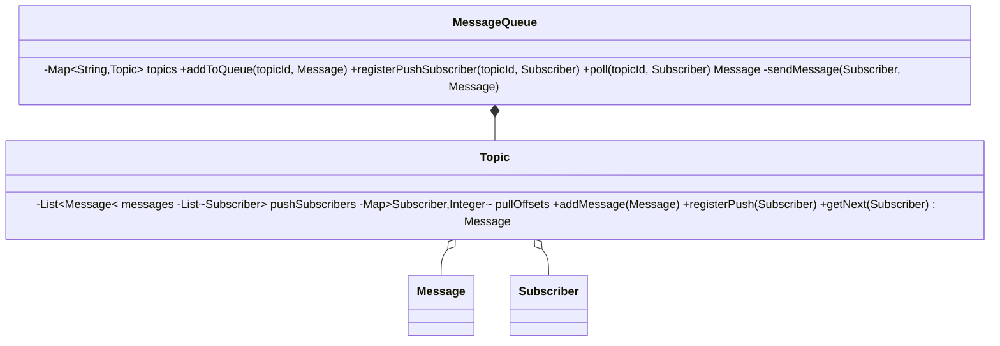

# Case study: pub/sub message queue

Use this when building an in-process event bus, outbox dispatcher or queue; when state has drifted into several maps keyed by the same id; or when you must choose pull vs push, who owns consumer offsets, retries and back pressure. [L90]

## Problem and scope

Design an in-memory pub/sub queue: publishers add messages, consumers receive only the event kinds they care about. The first cut grew parallel maps all keyed by topic id (messages, push subscribers, subscriber -> offset, and briefly subscriber -> subscription type). It worked, but the instructor judged it would fail review: `map.get().get().put()` chains, state synced by hand, callers reaching into internals. [L90]

**Engineering product rule:** the customer is another engineer, so skip use-case and class diagrams; start from the API list and let classes fall out of what the APIs need. Flips for consumer products (Twitter, Zomato), where actors and flows drive the design. [L90]

## Requirements

**Full list:** publish, subscribe, push delivery, pull/poll, batch push/poll, flush/delete, retries, dead-letter queue, back pressure, DB persistence and restart, delivery guarantees, secure topics. [L90]

**Shortlisted for 45 minutes:** add, register push subscriber, poll, internal push. Parked explicitly: batch, flush, retries, DB. [L90]

## Entities and APIs

Public surface [L90]:

| API | Notes |
|---|---|
| `addToQueue(topicId, message)` | Push to subscribers happens inside this call |
| `registerPushSubscriber(topicId, subscriber)` | Only push consumers register (renamed from "initialize") |
| `poll(topicId, subscriber)` | Returns the next message; offset stays internal |

Push is not an API: nobody "calls push". Pull consumers need no registration, like checking offers yourself vs asking a store to notify you. [L90]

Routing by topic beats queue-side per-consumer filtering and consumer-side discard-everything. [L90]



## Core algorithm and data structures

**Collapse parallel maps into one aggregate.** Several maps sharing a key and always accessed together become one `Map<id, Topic>` whose class owns the parts behind intention-revealing methods. The instructor could not name it as a pattern; it is plain encapsulation (an aggregate in DDD terms). [L90]

```java
class Topic {
  private final List<Message> messages = new ArrayList<>();
  private final List<Subscriber> pushSubscribers = new ArrayList<>();
  private final Map<Subscriber, Integer> pullOffsets = new HashMap<>();
  void addMessage(Message m) { messages.add(m); }          // validation hook here
  Message getNext(Subscriber s) {                          // read-fetch-advance, one place
    int i = pullOffsets.getOrDefault(s, 0);
    if (i >= messages.size()) return null;                 // gap left in class (inferred)
    pullOffsets.put(s, i + 1); return messages.get(i);
  }
}
```

- Fields private; callers use `topic.addMessage(m)`, never `topic.getMessages().add(m)`, so the owner can add validation or swap structures later. [L90]
- "Get offset, fetch at offset, bump offset" is one method on the owner; splitting it leaks the offset and lets state change between calls. [L90]
- Offsets are named `pullOffsets`: only pull consumers have a position; push consumers get each message as it is added. [L90]
- Retain messages; reads move an offset. A destructive pop would make other subscribers lose the message. Cost: memory grows with lagging subscribers. [L90]
- The queue, not the topic or the subscriber, broadcasts, because it owns routing to subscriber endpoints. [L90]

```java
public void addToQueue(String topicId, Message m) {
  Topic t = topics.get(topicId); t.addMessage(m);
  for (Subscriber s : t.getPushSubscribers()) sendMessage(s, m);   // internal push
}
```

Worked check: messages 1-5, analytics has consumed through 3, polls without stating position, receives 4. Unregistered pull consumers start at 0. [L90]

## Concurrency

Not covered in class (inferred): `getNext` read-increment must be atomic per (topic, subscriber); `messages` needs a concurrent append-only structure; one slow push subscriber must not block the fan-out loop, so use a per-subscriber executor or queue. [L90]

**Delivery reliability (discussed, not coded)** [L90]:

- **Retry:** exponential backoff (about 1s, 5s, 30s, 2m, 2m), capped attempts, then a dead-letter queue that is logged and analysed. You cannot hold unacked messages forever; the DLQ proves the message was received.
- **Back pressure:** per push subscriber, lower the send rate on failures (50 -> 40 -> 30 per second), buffer the rest for retry. Meaningless for pull, which is self-paced.
- **Durability with a DB:** write synchronously on `add`, ack the publisher only after the DB accepts; on repeated failure remove from the in-memory topic and return a retryable error. On restart rebuild topics, registrations and offsets before serving.

## Patterns used and rejected

| Choice | Decision | Why |
|---|---|---|
| Topic aggregate | Used | Removes sync burden of parallel maps [L90] |
| Push as public API | Rejected | It is a side effect of add [L90] |
| PULL/PUSH subscription type on register | Rejected | Only push needs registering [L90] |
| Consumer-stored offsets | Rejected | Every consumer must persist and recover its cursor; only gain is self-service replay. Broker-held (Kafka/ZooKeeper consumer-group style) with an admin reset for replay [L90] |
| Separate `getOffset` + `getMessage(offset)` | Rejected | One `getNext` [L90] |
| Return offset from poll | Rejected | Return the message, keep offset internal [L90] |
| Hard delete / flush | Rejected | Soft delete: per-message flag for all subscribers, advance one subscriber's offset for one; or no feature [L90] |
| Both pull and push per topic | Allowed | Happier clients, but you pay both sets of costs [L90] |
| "Apply the pub/sub pattern" | Moot | You are building the pattern [L90] |
| Single node vs partitions | Single node | SPOF acknowledged; partitions add complexity [L90] |

## Tests

- Poll returns messages in order per subscriber and independently across subscribers. [L90]
- Poll past the end returns nothing and does not advance. [L90]
- Push subscriber receives on add. [L90]
- Failed push goes through retry then DLQ. [L90]
- Restart restores offsets and registrations. [L90]

## Extensions and trade-offs

- **Pull vs push:** pull needs retention for slow consumers and lets the consumer set the pace (suits long jobs polled for status, such as a code submission checked every second); push gives low latency (payment completion) but needs fast broadcast, retries and back pressure. [L90]
- **Batch push/poll:** a wrapper over single operations; the hard part is partial acks (sent 1-6, acked 3, 5, 6, so resend 1, 2, 4). [L90]
- **Why a queue at all:** publisher does not know consumers and vice versa; the queue owns distribution rate and fan-out. Costs: you do not know who depends on your event schema, an extra hop, async latency, a delivery-guarantee choice (at-least/at-most/exactly once, per queue or topic), security (permissioned or encrypted topics checked at registration), SPOF. [L90]
- **Language idioms:** use them to look professional (Go channels, Java futures and exceptions). [L90]

## Pitfalls the course hit

- Registered pull consumers with a subscription type, then walked it back. [L90]
- Forgot to initialise offsets on registration; fixed with `getOrDefault(0)`. [L90]
- No bound check for "no new message" in `getNext` (inferred gap). [L90]
- Everything in one file; move models into a package before the PR. [L90]
- In an interview, stating the encapsulation benefit is often enough without a full refactor. [L90]

## What transfers to production

- Model `Topic` as the aggregate (log, push subscribers, offsets); keep the public surface to publish, subscribe, poll. Reviewers reject parallel `Map<topicId, ...>` structures. [L90]
- Ack publish only after the durable write; a readiness gate holds traffic until recovery completes. [L90]
- Per-subscriber retry with backoff and jitter (jitter inferred), max attempts, DLQ with replay context, adaptive per-subscriber rate. [L90]
- Server-side offsets per (topic, consumer group) with an admin reset. [L90]
- Version event schemas and keep a registry of consumers per topic, since publishers cannot see them. [L90]
- Machine-coding variants (event bus) expect more code and tests than this LLD discussion; see the event-bus case study. [L90]
