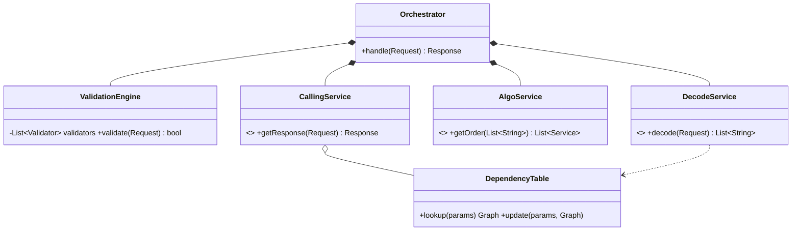

# Case study: orchestration service (dependency-ordered fan-out)

Use this when a request must call several downstream services, some of which need another's output first, and the request-to-services mapping can change at runtime. Typical shapes: API gateway aggregation, checkout flows, broker order placement, telecom call setup. [L85]

## Problem and scope

The interview prompt: the orchestrator is given a set of service dependencies, receives client requests, calls the CPU-heavy downstream services in a valid order and returns one response. Grounding examples from class [L85]:

- Telecom call setup: profile, billing rate, route choice, legality, whether to record; each answer comes from a different service.
- E-commerce order: inventory check, then pincode serviceability.
- Broker order: validate the user first, then funds (buy) or holdings (sell). A failed validation stops everything.

The pain: some services need others' results, and the routing table that says which services a request needs is updated while requests are being served.

## Requirements

**Full list raised:** validate the request; work out which services it needs; order calls by dependency; pass earlier outputs to later services; combine into a response; notify on failure; support adding, removing and scaling services at runtime; run CPU-heavy services efficiently; multiple orchestrator instances sharing the table. [L85]

**Shortlisted for a 1-hour LLD:** validate, decode into parameters, order by dependency, call in order, respond, and name the concurrency risk on the shared table. Parallel execution, event-driven orchestration and frameworks were deferred. [L85]

## Entities and APIs

| Entity | Role |
|---|---|
| `Orchestrator` (System) | Owns the pipeline; composed of the parts below |
| `ValidationEngine` | List of validators, stop at the first failure (composition: has no meaning outside the orchestrator) |
| `DecodeService.decode(Request): List<String>` | Turns a request into routing parameters |
| `AlgoService.getOrder(List<String>): List<Service>` | Topological sort over the required services |
| `CallingService.getResponse(Request): Response` | Calls services in order, owns the dependency table |
| `Request {uri, description, params, headers}` | Headers better as a key-value map |
| `Response {int cost}` | Kept concrete on purpose, generalise later |
| Dependency table | Parameter combination -> services, plus service -> prerequisites |

Every stage sits behind an interface so it can have several implementations or versions (v1, v2 of the calling service) without callers changing. [L85]



## Core algorithm and data structures

**Pipeline:** validate -> decode -> order -> call -> respond. [L85]

```java
Response handle(Request r) {
  if (!validation.validate(r)) throw new InvalidRequest();   // fail fast
  List<String> params = decoder.decode(r);
  List<Service> order = algo.getOrder(params);               // topo sort
  Context ctx = new Context(r);
  for (Service s : order) ctx.put(s, s.call(ctx));           // later reads earlier
  return ctx.finalResponse();
}
```

- **Topological sort (Kahn):** compute in-degrees, queue zero-in-degree nodes, pop and append, decrement children. If A needs B and C, and C needs B, the order is B, C, A. O(V + E). If fewer nodes are emitted than exist, there is a cycle: reject the config (inferred). [L85]
- **Routing as data:** a lookup table from parameter combination to required services keeps routing rules out of `if` chains. [L85]
- **Per-request context:** an immutable request plus a map of service results, so later services read earlier outputs without shared mutable state (inferred). [L85]

## Concurrency

- The only real race: the dependency table is read on every request and occasionally written (service added, removed, scaled). A reader must never see a half-written entry. [L85]
- Course fix: write lock on updates (read-write lock). If the table is in a shared database across instances, lock there and accept that readers wait during the rare updates. [L85]
- A student suggested `ConcurrentHashMap`; the instructor agreed it is the right choice in real code but used plain locks to teach the basics. [L85]
- Better (inferred): build a new immutable graph and swap one `AtomicReference`. Readers take no lock, and one request sees one consistent snapshot for both lookup and sort.

```java
AtomicReference<Graph> table = new AtomicReference<>(Graph.empty());
Graph snapshot = table.get();                 // read once per request
void update(Graph next) { next.assertAcyclic(); table.set(next); }
```

- Services are CPU-heavy, yet the class ran them one after another. In production, run each topological level in parallel on a bounded executor with a timeout per call (inferred). [L85]

## Patterns used and rejected

| Choice | Decision | Why |
|---|---|---|
| Interface per stage | Used | Swappable and versionable stages, stable method names [L85] |
| Validator list (chain/strategy) | Used | Add checks without touching the engine (shape inferred) [L85] |
| Composition for engine parts | Used | Parts have no life outside the orchestrator; aggregation if they could [L85] |
| Decoder as a plain entity | Rejected | A service with an interface can be swapped [L85] |
| Table owned by the decoder | Rejected | Owned by the calling service so others can reuse it [L85] |
| Hard-coded call order | Rejected | Breaks on every new dependency; derive it from the graph [L85] |
| Spring / frameworks | Deferred | Kept out of LLD [L85] |
| Event-driven orchestration | Deferred | Asked by a student, not covered [L85] |

## Tests

- Diamond dependency yields a valid order (B before C before A). [L85]
- Cycle in config is rejected at load (inferred). [L85]
- Validation failure means zero downstream calls. [L85]
- Concurrent reads during table updates never observe a torn state. [L85]
- Later service receives the earlier service's output through the context.

## Extensions and trade-offs

- **Lock in a shared DB vs throughput:** updates must be serialised anyway and are rare, so readers waiting is accepted. [L85]
- **Concrete example vs generic S1/S2/S3:** start concrete to surface real dependencies, then generalise. [L85]
- **Interview scope:** a 1-hour LLD round names the concurrency risks; a longer machine-coding round implements them with a runnable main. The instructor judged the reported round to be machine coding, and agreed concurrency is gaining weight in interviews. [L85]
- **Caching orders:** compute the topological order once per parameter set and cache it alongside the snapshot (inferred).
- **Partial failure:** what happens when service 3 of 5 fails (retry, compensation, partial response) was not covered; a reviewer should ask (inferred).

## Pitfalls the course hit

- The original candidate stopped at class definitions and never reached the dependency structure. [L85]
- Lookup and sort can read different versions of the table unless one snapshot is taken per request; left open in class. [L85]
- Response modelled as `int cost` is a placeholder; do not let it leak into the interface for long. [L85]
- The class was fairly shallow on the multithreading the prompt hinted at. [L85]

## What transfers to production

- Keep the service DAG as validated config: reject cycles at load, swap atomically on change. [L85]
- Validate first and fail fast; no side effects for invalid requests. [L85]
- Parallelise independent nodes (`CompletableFuture` joined on prerequisites in Java; `errgroup` in Go; `Promise.all` per level in JS) with timeouts (inferred).
- Reviewer checks: one snapshot per request; config updates never block the request path; behaviour on mid-pipeline failure; each stage behind an interface.
- Pre-class cost aside: measure the real bottleneck (memory, not CPU, in the instructor's own stack) before resizing, and weigh developer time against instance cost. [L85]
