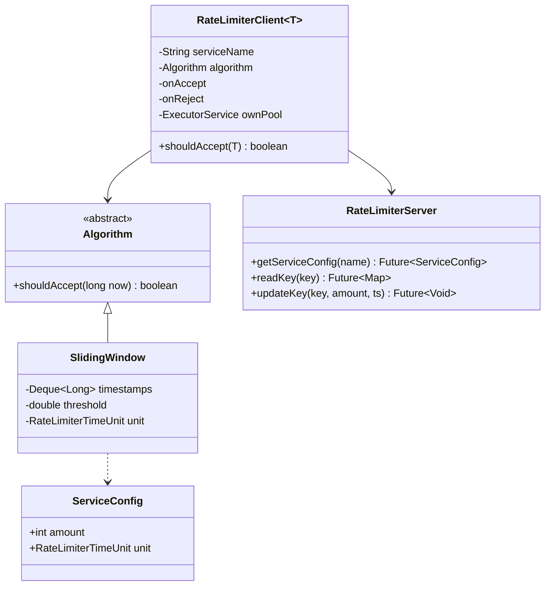

# Case study: rate limiter (client library plus config server)

Use this when adding request limiting to a service, writing an embedded SDK that talks to a control-plane server (rate limits, quotas, feature flags), or doing "machine-code a rate limiter" [L71-L81].

## 1. Problem and scope
- Overload example: capacity about 1M requests/s, Black Friday load 2M. Caching, dropping low-value work and scaling are slow or impractical at peak, so the edge says yes or no per request and sheds the excess [L71].
- The limiter only accepts or rejects. Graceful degradation (WhatsApp prioritising the "reached server" tick at New Year) is a different mechanism and excluded [L71].
- Capacity is count over time, so every decision takes time and a count [L71].

## 2. Requirements (full -> shortlisted)
| Requirement | Decision |
|---|---|
| Per-service, per-key limits with a time unit (100 registrations/s, 10 OTP SMS/s, 1000 marketing SMS/hour) | Core [L74] |
| Local accept/reject decision, no network on the hot path | Core [L72, L73] |
| Accept/reject callbacks supplied by the caller | Core [L73, L77] |
| Configs held on a server with a DB, read by clients | Core [L72, L76] |
| Global limit across instances via batched heartbeats | Designed, stubbed in code [L72, L74] |
| Back pressure (adapt the limit on rejects) | Built simply [L80] |
| Custom rules ("3 per user on Sundays") | Composite key `userId_date`, unit DAY, amount 3; no rule language [L74] |
| Fail open when the limiter or a heartbeat is lost | Default [L72, L74] |

Failure handling options laid out: do nothing, log to a queue/DLQ/metrics, caller callback, back pressure. The coding round starts with do-nothing and treats the rest as extensions [L71].

## 3. Entities and APIs

- Server side: `ApiGateway` (parses JSON, owns a fixed pool) -> controllers (`RateLimiter`, `ServiceConfig`) -> DAOs -> `DBConnector`. Packages: models, requests, responses, controllers, dao, db, gateway [L75, L76].
- `ServiceConfiguration{service, key, limit, timeUnit}`; `UpdateRequest extends Request{count, timestamp, key}` is the heartbeat "service S saw N more hits on key K at T". Inheritance here because an update request is a request [L75].
- The field is a neutral `key`, not "request", because it can limit anything [L74].
- Callbacks return `CompletableFuture<Void>`: `void` gives no completion signal, `Object` forces casts, plain `R` blocks and surfaces side-effect exceptions [L73, L77].
- Service name is fixed per client, not passed per call; null callbacks are no-ops via overloaded constructors [L77].
- `RateLimiterTimeUnit {SECOND, MINUTE, HOUR, DAY}` matches the server contract; Java `TimeUnit` would let nanoseconds through and fail late [L80].

## 4. Core algorithm and data structures
Sliding window log with back pressure [L78, L80, L81]:
```java
synchronized boolean shouldAccept(long now) {
  long cutoff = now - unit.toMillis();
  while (!ts.isEmpty() && ts.peekFirst() <= cutoff) ts.pollFirst();
  if (ts.size() < threshold) {
    ts.addLast(now);
    threshold = min(max, threshold + 0.1);   // gentle forward pressure
    return true;
  }
  threshold = max(min, threshold - 1);       // back pressure
  return false;
}
```
- Store only timestamps; the resource type is irrelevant, so the generic was dropped from the algorithm [L78].
- Prune at the top of every check; the log is append-ordered, so evict from the head and stop at the first live entry instead of filtering the whole list [L81].
- Forward pressure of +1 per accept never rejects (positive feedback); use a fraction or nothing. -1 on reject vs +0.1 on accept was called harsh but acceptable: fast to react, slow to recover. A recency-weighted variant (recent failure -1, older -0.1) was shown and deferred [L80].
- Threshold as a double; integer math with `+= 0.1` silently does nothing (inferred) [L80 notes]. Clamp to [min, max] (inferred).
- Memory O(limit) per key; for high limits use a sliding-window counter or buckets (inferred) [L81 notes].
- `synchronized` above is not in the course (inferred, see section 5).

## 5. Concurrency
- **Decision path:** sync boolean, local, no I/O. `Future<Boolean>` was rejected to keep it fast [L73].
- **Threads at the edges.** The gateway owns a pool and the DB class owns its own; controllers create no threads and parse nothing [L75, L76].
- Continuations use async variants on an executor; `thenAccept` on the reading thread blocks it [L75].
- **Library pool for its own I/O, caller threads for caller callbacks.** The client runs server calls on a small private executor (1-2 threads; 10 was called impractical for a library); `onAccept` / `onReject` run where the caller chooses, so the library does not set their priority or starve its own pool [L77, L80].
- **No I/O in constructors.** `SlidingWindow` needs a `ServiceConfig` the client only has as a future. Blocking `.get()` in the constructor works but needs broad exceptions; the preferred fix is to resolve config at the creator and inject it (dependency inversion) [L78, L79].
- Remote methods return futures even for a thin client, so the signature admits an RPC [L79].
- Not covered: prune, size check and append must be atomic per key when several request threads call it; use a lock or a per-key single-thread executor (inferred) [L80, L81 notes].

## 6. Patterns used and rejected
- Strategy for the algorithm (null means sliding window); DAO; gateway / controller layering; DI by constructor [L76, L78, L79].
- Rejected: server deciding per request (latency, server in every path) [L72, L74]; client only with no server (no global limit, no config push) [L72]; server without a DB [L72]; per-event reporting instead of batching [L72]; rich rule language [L74]; fail closed by default (single point of failure; use only when over-admission is worse than outage) [L74]; SQL in controllers [L76]; decision logic inside callbacks or IO methods [L78]; `String` time units [L80]; a separate back-pressure class (deferred until coupling hurts) [L73].

## 7. Tests
The course has no test lesson for the limiter. Recommended (inferred from L72, L80, L81 notes):
- Injected clock: fill to the threshold, advance past the window, acceptance resumes; test `t == cutoff`, all expired, none expired.
- After N accepts with forward pressure, a request over the base limit is still rejected; K rejects lower the threshold by the expected amount; the floor holds.
- Unsupported time unit fails at config build.
- Simulate N clients against one fake server; totals converge near the global limit; kill the server and confirm fail open.

## 8. Extensions and trade-offs
- Client-side decisions: fast, simple server, approximate global enforcement. The network hop is paid only on config read and update [L74, L81].
- Fleet example: three instances at 100 rps against a 270 global limit must be told to cut back; heartbeats return the global count (60 of 70) and clients admit only the headroom [L72, L74].
- Batching saves bandwidth and delays the server's view [L72].
- Missed heartbeat: keep the last state and keep accepting [L74].
- Static threshold is predictable; back pressure protects a degraded downstream but also sheds fine requests [L71].
- Real projects generate request classes from a contract (Thrift, proto) and use a DI framework; hand-written here for teaching [L76].

## 9. Pitfalls the course hit
- **Contradiction:** L71 says the course will code a timer wheel and calls back pressure a separate algorithm; L78-L81 actually code a sliding window log with back pressure. Treat the sliding window as the final position.
- Window that never slid until L81 added pruning [L80, L81].
- Positive feedback loop from +1 forward pressure [L80].
- Pointless generic `T` and two meanings of "request" in one scope [L78].
- `throws Exception` used for brevity and labelled bad [L79].
- Request models demanding `serviceName` / `requestId` they cannot know; let the client stamp them [L77].

## 10. What transfers to production
- Shape: middleware calls `tryAcquire(key)` against local state; a control-plane service stores limits; clients pull updates every few seconds [L72 notes].
- Reviewer checks: no network I/O on the decision path; `.get()` never on a request thread and never without a timeout; explicit fail-open or fail-closed per key; bounded report buffer; heartbeat interval separate from limit windows [L72, L74, L79 notes].
- Use a monotonic or injected clock; sweep idle keys, which never call `shouldAccept` and keep stale entries (inferred) [L81 notes].
- Wire remote config at the composition root, then build domain objects with plain values; they become testable with a hand-built config [L79 notes].
- Size sync lag against tolerated overshoot; alert on stale last-known state (inferred) [L74 notes].
