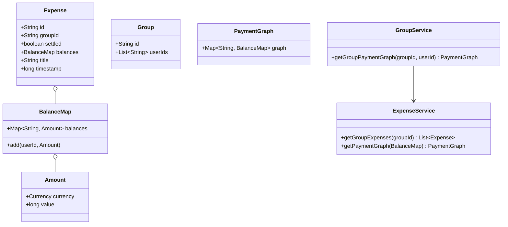

# Case study: Splitwise (expense sharing and debt simplification)

Use this when building anything that tracks who owes whom (group expenses, inter-company netting, marketplace payouts, wallet clearing), or when you get "design Splitwise" in a timed machine-coding round [L42-L50].

## 1. Problem and scope
- The full product cannot be finished in about two hours. Comments, notifications and activity feeds each cost roughly an hour, and a candidate who starts there never codes the hard part [L42].
- The hard part: track balances and simplify a group's debts into few direct payments [L42, L50].
- Example: A owes B 10, B owes C 20. Nets: A -10, B -10, C +20, so A pays C 10 and B pays C 10; B stops passing money through. Add "C owes A 10" and the cycle collapses to one payment, B pays C 10 [L42].
- Simplification is offered, not forced; users who do not opt in settle pairwise [L42].

## 2. Requirements (full -> shortlisted)
| Feature | Decision |
|---|---|
| Add expense | Core |
| Edit expense | Core |
| Settle expense (keep record, mark settled) | Core |
| Group expenses (add / edit / settle) | Core |
| Simplify debts (payment graph) | Core, the part you code |
| Comments for disputes | Out |
| Activity log of every change | Out |

Settling never deletes or rewrites the expense; it flips a `settled` flag that calculations filter on [L42, L43].

## 3. Entities and APIs

- `Map<User, Amount>` over two parallel lists; money as a value object with currency, not a bare int. `Balance` was renamed `Amount` because the old name implied a transaction [L43, L47].
- `Group` holds user ids, not users, and not a growing list of expenses. Group-to-expenses lives in a separate association (`GroupExpenses`), and `groupId` is also stored on the expense for reverse lookup: deliberately redundant, not 3NF [L43, L47].
- Nested `Map<User, Map<User, Amount>>` was wrapped into named types (`BalanceMap`, `PaymentGraph`) [L47].
- Services: `GroupService` checks membership, sums balances across the group's expenses, then asks `ExpenseService` for the graph. The same graph method works for one expense or the whole group [L46].
- `userId` on the group API exists for a membership check that throws; an unchecked auth parameter is a smell [L46, L47].
- CRUD (`getUser`, `getGroup`, `getExpense`) is stubbed; time goes to the graph [L45, L46].

## 4. Core algorithm and data structures
Greedy over two max-heaps of net balances [L44, L48]:
```java
PaymentGraph simplify(BalanceMap net) {          // sum must be zero
  PriorityQueue<Entry> receivers = maxHeap(positive(net));
  PriorityQueue<Entry> payers    = maxHeap(absOfNegative(net));
  while (!receivers.isEmpty()) {
    Entry r = receivers.poll(), p = payers.poll();
    long x = min(r.amount, p.amount);
    graph.add(p.user, r.user, x);                 // p pays r x
    if (r.amount > x) receivers.add(r.minus(x));
    if (p.amount > x) payers.add(p.minus(x));
  }
  return graph;
}
```
- Six users A +90, B -70, C -40, D +80, E -100, F +40 give four edges: E->A 90, B->D 70, C->F 40, E->D 10 [L44, L48, L49].
- O(n log n), at most n-1 edges [L48].
- **Not optimal.** Receivers {80, 25} against payers {20, 20, 20, 20, 25}: optimal is 5 edges, greedy gives 6. "Match equal amounts first" fixes that case but is defeated by splitting 25 into 23, 1, 1 (optimal 7, greedy 8). Keep equal-match as an optimisation, not a guarantee [L44].
- Exact minimum is a subset-sum style search, exponential in general; right only for tiny groups where minimum transfers is a hard requirement [L44, L48].
- Heaps over sorted lists: the leftover must be re-inserted in order after every step [L48].
- Run on netted balances, never on raw expenses [L48].
- Group balances are summed on read from the expenses: simple and consistent, O(n) per call (inferred).

## 5. Concurrency
- Editing an expense from {A -10, B +10} to {A -5, B +5} field by field lets a reader see {A -10, B +5}, which does not sum to zero [L45].
- **Chosen:** treat the balance map as one immutable value; build the new map and swap the reference. Readers get the old or the new snapshot, stale but always valid [L45].
- **Alternative:** a read/write lock on the balances gives current data but readers wait; prefer it when staleness is unacceptable [L45].
- Rule stated: stale is acceptable, inconsistent never. Cache only immutable values [L45].
- `getGroupPaymentGraph` is cached; invalidate on any create / edit / delete in that group (inferred from L45).

## 6. Patterns used and rejected
- Composition over a big object with many fields; interfaces over class inheritance that mixes behaviours from several parents [L46].
- Value objects (`Amount`), named wrappers over nested collections [L43, L47].
- Rejected: models-first coding in a timed round (you may never reach the algorithm), a real DB or Redis wrapper (in-memory maps instead), `sumExpenses` returning a fake `Expense` (return the honest `BalanceMap`) [L47].

## 7. Tests
- Group balance: users A, B, C; expenses (+10, +20, -30), (-50, +10, +40), (+90, 0, -90); expect A 50, B 30, C -80. The first run returned last-expense values because `add` did not add [L49].
- Payment graph: the six-user case above, four edges. Do not assert edge order; the output is a graph [L49].
- Key balances by user id so tests do not build heavy `User` objects; expose a create method rather than constructor-injecting a prebuilt map [L49].
- Replace `System.out` inspection with asserts [L49].
- Worth adding (inferred): zero-sum input assertion, applying the edges zeroes every balance, edge count <= n-1, all-zero group, one creditor with many debtors, the counterexamples as fixtures that document non-optimality [L44, L48 production notes].

## 8. Extensions and trade-offs
- Greedy vs optimal: simplicity and speed for occasional extra edges (6 vs 5, 8 vs 7). The instructor takes greedy [L44, L48].
- Redundant `groupId` buys a direct lookup at the cost of two places to keep consistent [L43].
- Keeping a `User` class even though functions need only ids: cheap clarity [L47].
- Discussion vs coding: about 25-30 minutes of discussion before coding, roughly 35/25 board vs code in one framing; the instructor favours the discussion [L45, L50].
- Product nuance: the greedy can create edges between people who never shared an expense; restricting suggestions to existing relationships changes the algorithm (inferred).

## 9. Pitfalls the course hit
- Heap returned the wrong extreme: read the comparator contract and negate for descending [L48].
- Coding forward with no target shape: declare the result map first, then fill it [L48].
- Accumulator that did not accumulate [L49].
- Code drifting from the agreed design; keep looking back at the whiteboard example [L49].
- Starting from `User`, registration and auth; periphery-first build [L50].

## 10. What transfers to production
- Amounts in integer minor units or decimals with a currency, never doubles; assert one currency per run. Rounding residue (100/3) otherwise leaves dust edges or loops (inferred) [L44, L48].
- Stable tie-break on user id so the same balances always give the same suggestions, which matters for caching, tests and UIs (inferred) [L48].
- Reviewer checks: input sums to zero, both heaps empty at the end, applying the graph zeroes all balances, edges <= n-1 [L48].
- Multi-field invariants on shared state: swap an immutable snapshot or lock; never update field by field [L45].
- Financial records are append or flag, not delete [L42, L43].
- Every group-scoped read carries the caller id and a membership check in the owning service [L46].
