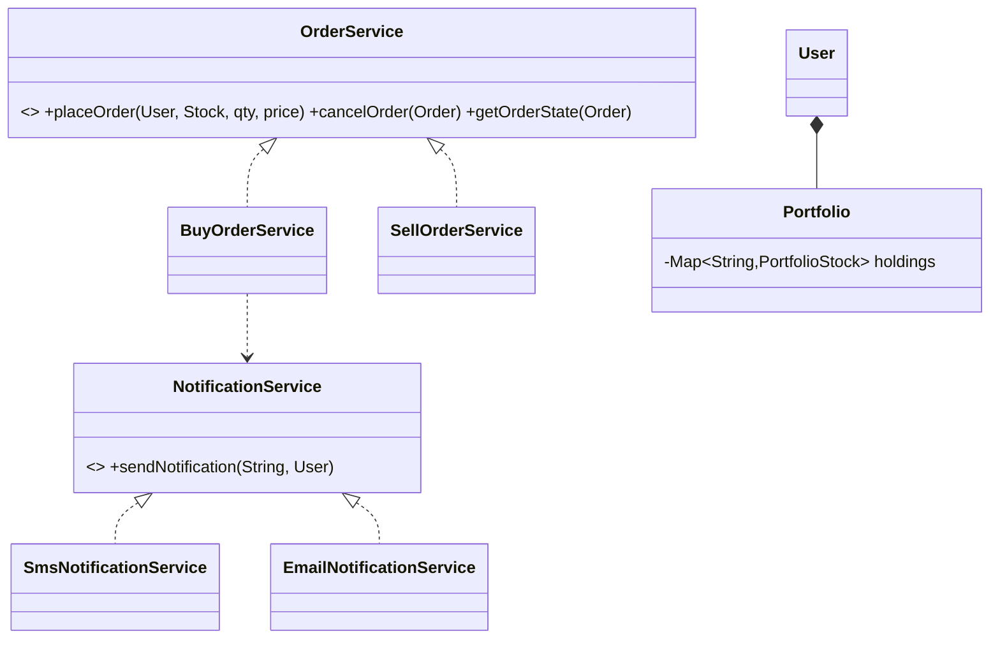

# Case study: stock trading app (Zerodha-like broker)

Use this when designing an order pipeline with buy/sell variants, a portfolio or wallet, and notifications; or when you must decide whether Strategy or Observer is justified, or interface vs abstract class. [L87]

## Problem and scope

"Design Zerodha" cannot be built in an hour. Run as a mock interview: list use cases per actor, then let the interviewer cut to 3-4 features. The core difficulty is one `placeOrder` call with two different flows (buy: check funds, debit wallet, update portfolio; sell: check holdings, remove stock, credit wallet), plus market vs limit orders with different execution timing. [L87]

## Requirements

**Full list (5-10 minutes).** User: view prices and watchlist, place buy/sell market/limit orders, view portfolio, search stocks, past orders, profile. Platform: auth and users, notifications, execute with the exchange, stock list and price updates, search, validation, portfolio management. [L87]

**Shortlisted by the interviewer:** view prices, place order, portfolio, search. Limit-order book (orders waiting for a price match) acknowledged as real behaviour but dropped for time. [L87]

## Entities and APIs

| Entity | Fields | Modelling decision |
|---|---|---|
| `Stock` | id, price, metadata | Price is server state |
| `User` | email, password, walletBalance, Portfolio, Watchlist, ActiveOrders | Owns Portfolio by composition (one each, no life apart) |
| `Portfolio` | userId, `Map<stockId, PortfolioStock>`, moneyInvested, currentValue | Map for O(1) update by stock |
| `PortfolioStock` | quantity, averagePrice | |
| `Order` | id, stock, user, price, qty, isBuy, `OrderType`, `OrderState` | Enum for type and state; boolean only for buy/sell |
| `Notification` | description, type, actions | |

Rules behind those choices [L87]:

- A mutated collection (active orders, watchlist, holdings) gets its own class, not a raw `Map`/`List` on the parent.
- Closed set with more than two values, or likely to grow, gets an enum. The instructor started with `isLimitOrder` and switched to `OrderType` once a student raised GTT orders.
- Never take market price from the request; read it from server-side stock state. Limit price comes from the user.

**Services (SRP, in-memory store):** `UserService` (CRUD, add/withdraw wallet, reject withdrawal over balance), `StockService` (getPrice, setPrice, addStock for IPOs, search), `OrderService` + `ValidationEngine`, `NotificationService.sendNotification(description, user)` with SMS and email implementations. [L87]

**Expose only user-facing endpoints:** place buy order, place sell order, login, user details, get portfolio, get stock info, get watchlist. Never internal steps such as exchange execution. [L87]



## Core algorithm and data structures

**Place-order flow:** create Order (IN_PROGRESS) -> `ValidationEngine.validate` (auth, funds or holdings) -> on fail, notify the reason and mark FAILED -> on pass, debit or credit, execute at the exchange, update portfolio, mark SUCCESS, notify. [L87]

**Average price on buy**, O(1) via map. Check: 2 at 100 then 2 at 150 gives 4 at 125. [L87]

```java
void addToHolding(String stockId, long qty, long price) {
  PortfolioStock ps = holdings.computeIfAbsent(stockId, k -> new PortfolioStock());
  ps.avgPrice = (ps.avgPrice * ps.qty + price * qty) / (ps.qty + qty);
  ps.qty += qty;
  moneyInvested += price * qty;   // current value derived from live prices
}
```

Edge cases: one stock per order (baskets are separate orders); IPO adds a stock; cancel and getOrderState matter for pending limit orders. [L87]

## Concurrency

Not implemented in class. Raised: with 100 nodes, the service owning order state changes it, and clients should receive pushed events (SSE) rather than poll. For real code, a wallet debit and its funds check must be one atomic step (lock per user or a conditional update), or two concurrent buys can overdraw (inferred). [L87]

## Patterns used and rejected

| Pattern | Decision | Reason |
|---|---|---|
| Strategy: `BuyOrderService` / `SellOrderService` behind `OrderService` | Used | Same signature, different algorithm chosen at runtime [L87] |
| Interface per notification channel | Used | Channel selection polymorphic, no if/else on type [L87] |
| Observer for "notify the user who placed the order" | Rejected | One fixed recipient; nothing subscribes or unsubscribes [L87] |
| Observer for order-status fan-out to notification, invoice, analytics | Accepted | Several subscriber types that change over time [L87] |
| Interface vs abstract class | Interface by default | Abstract class only when variants share real implementation [L87] |
| Separate `placeMarketOrder` / `placeLimitOrder` with an order book | Dropped for time [L87] |
| Request/response DTOs | Worth mentioning; explicit params kept for brevity [L87] |
| Auto-retry of failed orders | Rejected | Money and moving prices: fail, notify, let the user re-place (matches the real broker) [L87] |
| Chain of Responsibility vs Observer for post-events | Open | Asked, not answered [L87] |

Observer, as taught with a weather station: the smell is a publisher with a field per consumer and an explicit `x.update()` each. Replace with a list of one `Observer` interface plus add/remove, so adding a consumer does not edit the publisher (OCP, encapsulate what varies). The instructor first resisted Observer here, then accepted it for multi-service fan-out. [L87]

Why interfaces at all: loose coupling and dependency inversion; an `OrderService` v2 can add validation while honouring the same contract. [L87]

## Tests

- Buy and sell strategies tested independently. [L87]
- Average-price math, including partial sells. [L87]
- Withdraw over balance rejected. [L87]
- Insufficient funds or holdings: state FAILED, notification sent, wallet and portfolio unchanged.
- Market order ignores any price field on the request.

## Extensions and trade-offs

- **Full Stock vs stockId as parameter:** the front end usually has only the id and price must come from the server; settled on passing the stock with a server-held price. [L87]
- **Polling vs push for watchlists and status:** polling is simple but expensive with many clients. A student argued persistent connections limit scale; inspecting a live crypto exchange showed a streamed feed with per-coin subscribe/unsubscribe, so streaming is used. Detail is HLD. [L87]
- **Layering:** controller (routing, no logic) -> facade -> service (logic, DB calls); DTOs carry data only. [L87]
- **Limit-order book:** orders wait until price meets the limit; keep it separate from immediate market execution (inferred). [L87]

## Pitfalls the course hit

- Boolean for order type, corrected to an enum mid-class. [L87]
- Students reached for Observer because the name fit; the test is whether subscribers vary at runtime. [L87]
- Prices modelled as `int`, flagged as a simplification. [L87]
- A student asked to code it; the diagram became packages `dto`, `enums`, `services`. In LLD you give signatures and flow, maybe one method; running code is machine coding (2-3 hours). [L87]

## What transfers to production

- Order side and type as enums with a strategy per side. [L87]
- Money as decimal or long minor units, never `int` or `double` (inferred correction). [L87]
- Order status change emits a domain event; notification, invoicing and analytics subscribe; the order service imports none of them (on a distributed system, a message bus). [L87]
- Holdings keyed by instrument id; recompute average cost per fill; compute current value from live prices rather than storing it stale. [L87]
- Validation (auth, funds, holdings) is a separate engine run before execution; business failures are not retried. [L87]
- Reviewer checks: notification channel chosen polymorphically; market price never read from the request; only user-facing actions exposed; each pattern tied to a named variability.
