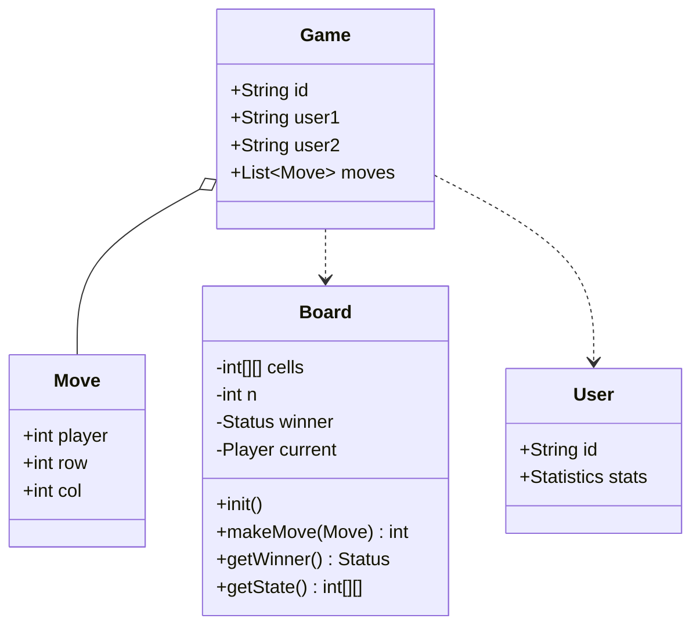

# Case study: tic-tac-toe in an interview

Use this when you get "design tic-tac-toe" (or any small n x n grid game) in a one-hour LLD round, or when a terminal check after each state change is scanning everything. Source is the standalone interview walkthrough [L93]; the long refactor version is in `game-engine.md`.

## 1. Problem and scope
- Open prompt with no stated features. The risk is designing tournaments, AI and ratings and never reaching the core [L93].
- The interviewer drills into two functions: `makeMove` and `getWinner`. Follow-up constraint: both O(1) on an n x n board [L93].
- Two levels must both show: an extensible object model and a tight algorithmic core [L93].

## 2. Requirements (full -> shortlisted)
| Candidate feature | Decision |
|---|---|
| Two players alternate on an n x n board | Build |
| Win / draw / in-progress result after each move | Build |
| Undo | Name, sketch (move log) |
| Timed moves (chess clock), spectators | Name only |
| User statistics, ratings, tournaments, AI | Name only |

Rule: list many features aloud, pick a small subset, keep the class diagram open for the rest [L93].

## 3. Entities and APIs
Model the central class first (the board), then grow the rest. Starting from `User` / `Statistics` over-details the periphery [L93].


- `Status`: P1_WON, P2_WON, DRAW, IN_PROGRESS. `current` toggles after each move [L93].
- Contract first: player in {0, 1}; `makeMove` returns 0 (no winner yet), +1 (player 1 won), -1 (player 2 won). A 0/1 result could not express "nobody yet"; the asymmetry was accepted and stated [L93].
- Cells are plain ints (+1, -1, 0). A rich `Square` object (occupant, under attack) is right for chess, overkill here [L93].

## 4. Core algorithm and data structures
Key insight: only the move just made can create a win, and only for the mover, on the lines through that cell [L93].

| Version | Work per move | Memory | Notes |
|---|---|---|---|
| Full board scan | O(n^2) | none extra | Rejected once you see only the last move matters |
| Scan lines through (r, c) | O(n), about 4n reads | none extra | Four loops merged into one with four flags |
| Running line sums | O(1) | O(n): `rows[n]`, `cols[n]`, `diag`, `anti` | Follow-up answer |

O(1) shape:
```java
int makeMove(int player, int r, int c) {
  int v = player == 0 ? 1 : -1;
  rows[r] += v; cols[c] += v;
  if (r == c) diag += v;
  if (r == n - 1 - c) anti += v;
  if (abs(rows[r]) == n || abs(cols[c]) == n
      || abs(diag) == n || abs(anti) == n) return v;
  return 0;
}
```
- With +1/-1 encoding a line can only total +-n if one player owns every cell [L93].
- Anti-diagonal membership: `r == n - 1 - c`. Diagonals are checked only if the move lies on them [L93].
- The sums assume each cell is written once: reject occupied and out-of-range cells first, or the aggregates corrupt silently (inferred).
- Draw needs a move counter (`moves == n*n`) (inferred).

## 5. Concurrency
- Not covered in the lesson. If several requests can hit one game, serialise `makeMove` per game id (lock or single-thread actor) so cell writes, sums, turn flag and move log change together (inferred).

## 6. Patterns used and rejected
- No named GoF pattern; the value is in contract design and incremental aggregates [L93].
- Merged loop over four copy-pasted loops: clarity wins over the lost early `break` [L93].
- Rich cell objects rejected for this domain [L93].
- If the game must grow into many board games, the patterns live in `game-engine.md` (rule set per board type, `CellBoard` interface, chain of AI placements) [L18, L26, L27].

## 7. Tests
Not coded in the lesson. Minimum table (inferred from the production notes of L93):
- Each win line: a row, a column, the main diagonal, the anti-diagonal, including the centre cell that sits on both diagonals for odd n.
- Draw on a full board.
- Illegal moves rejected without mutation: wrong turn, occupied cell, out of bounds, move after game over.
- Property test: the O(1) result equals a brute-force O(n^2) scan on random games.

## 8. Extensions and trade-offs
- **Undo.** Keep an ordered move list on `Game`. Tic-tac-toe can invert the last move (clear the cell; in the O(1) version also subtract `v` from the four sums (inferred)). Games with captures, castling or promotion replay moves 0..k-1 instead [L93].
- Replay is O(moves) and always right; inversion is O(1) but needs per-move inverse logic [L93].
- The move log also gives rollback on partial failure, export and replay [L93].
- O(n) extra memory buys constant-time win detection; the invariant must hold on every mutation path, undo included (inferred).
- Timed games: put limits in a composed config on the game, not in the board (see `game-engine.md`) [L21].

## 9. Pitfalls the course hit
- Four near-identical loops differing only in index [L93].
- Cryptic names (`cc`, `dd`); descriptive names are what a senior round grades [L93].
- Coding before the return contract was fixed, leaving ambiguous return values [L93].
- Recomputing global state after a local change [L93].
- From the long version: a row of empty cells counted as a win, NPE on a null first cell, overwriting an occupied cell went unnoticed [L3, L7, L13].

## 10. What transfers to production
- **Incremental aggregates.** Any "is a limit reached" check after a local change (per-tenant quota, per-bucket counters) should update a counter in the same critical section as the mutation, not rescan [L93].
- Reviewer check: every mutation path (apply, undo, reset, load from storage) updates the aggregates (inferred).
- **Append-only event log on the aggregate.** Turn-based flows, workflow steps and order state get undo, audit and rollback from it. Use snapshot plus replay when inverses are hard [L93, L29].
- **Validate at the API boundary.** Wrong turn and occupied cell return errors and never mutate state [L93].
- **Contract before code.** Fix inputs, outputs and the meaning of each return value; reviewers read signatures first [L93].

### Interview-only notes
- Narrate while coding; say the O(n) and O(1) versions and why the first insight unlocks both [L93].
- Name many features, build two [L93].
