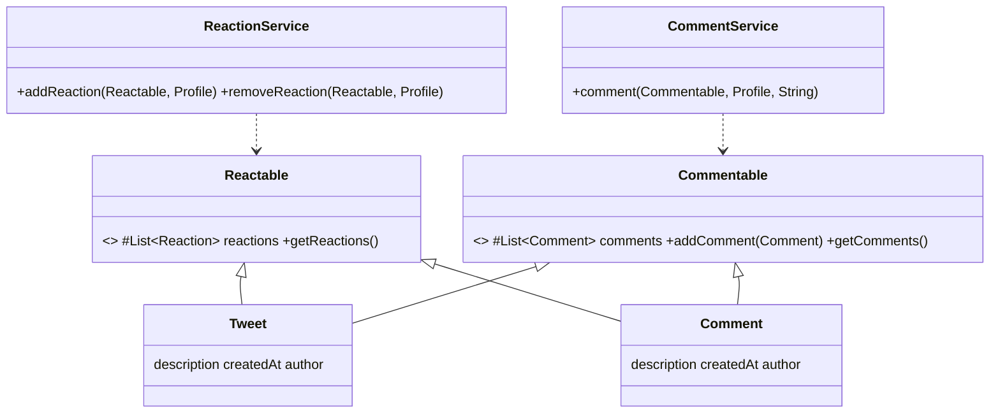

# Case study: Twitter (capability bases, hybrid timeline, trending)

Use this when sibling entities share the same collection and accessors (reactions, comments, attachments), when a service is growing one method per target type, when fanning out content to followers with skewed counts, or when a threshold should trigger a side effect. [L89]

## Problem and scope

Run as a mock interview with a TA as candidate. Three pains drove the design [L89]:

- Tweet and Comment each held `List<Reaction>` and `List<Comment>` with identical getters; ReactionService grew to four methods (add/remove on tweet, add/remove on comment) with the same two-line body. A new content type (Reels) would add two more per service.
- Push fan-out to every follower crashes when a celebrity tweets; most profiles have about 1k followers, a few have millions.
- Pull for celebrities scanned the whole tweet list per reader, O(N) per celebrity.

## Requirements

**Full list offered to interviewers:** tweet, react, comment threads, follow, timeline, explore/trending, notifications, search, retweet, polls. [L89]

**Shortlisted (one-hour box set at the start):** timeline, follow, trending, plus tweet/comment/react needed to support them. Deferred out loud: rich media types, follow requests for private profiles (would add `FollowRequest` and a pending list), auth. [L89]

Assumption stated before choosing fan-out: most profiles ~1k followers, few celebrities. [L89]

## Entities and APIs

| Entity | Fields |
|---|---|
| `Profile` | name (unique), tweets, followings, followers, isCeleb, timeline, lastSeen |
| `Tweet`, `Comment` | description, createdAt, author; reactions and child comments via capability bases (comments of comments form the thread) |
| `Reaction` | by (Profile), `ReactionType` enum |
| `Timeline` | tweets |

`Profile`, not `User`: one human can own several profiles, and the system only deals with profiles. [L89]

Services [L89]: `ProfileService` (create, delete), `TweetService.create(description, profile)` (sets `createdAt`, hands off to timeline), `CommentService.comment(Commentable, Profile, text)`, `ReactionService.addReaction/removeReaction(Reactable, Profile)`, `TimelineService`, `TrendingService` (one shared ranked list).



The diagram shows the intent; Java cannot extend two abstract classes (see Pitfalls).

## Core algorithm and data structures

**Capability extraction.** When siblings share a collection field and accessors, pull them into a base type; the service collapses to one method typed on the capability. Abstract class over interface because the shared list field and getter body are state and behaviour, not just a signature. Flips to an interface when only signatures are shared. [L89]

```java
class ReactionService {
  void addReaction(Reactable t, Profile by) {
    t.getReactions().add(new Reaction(by));
    if (t.getReactions().size() > THRESHOLD) trending.consider(t);   // 1000 in class
  }
  void removeReaction(Reactable t, Profile by) { t.getReactions().removeIf(r -> r.by == by); }
}
```

Remove is keyed by (target, profile) because the reaction lives on the target. [L89]

**Hybrid timeline** [L89]:

```java
void addToTimelines(Tweet t, List<Profile> followers) {   // push, normal authors only
  for (Profile p : followers) p.timeline.add(t);
}
List<Tweet> pullCelebTweets(Profile reader) {             // only on app open
  for (Profile c : reader.celebFollowings()) {
    int i = lowerBound(c.tweets, reader.lastSeen);         // binary search on createdAt
    out.addAll(c.tweets.subList(i, c.tweets.size()));
  }
  reader.lastSeen = now(); return out;
}
```

| Path | Cost |
|---|---|
| Push | O(followers) per tweet |
| Pull | O(C log N) per open, C = followed celebs, N = tweets per celeb |
| Naive pull | O(N) per celeb per reader |

Binary search is valid only because TweetService appends in creation order. Pull runs only when the user opens the app, never proactively for all users. [L89]

**Trending:** the service that mutates the counter (ReactionService) already holds the new count, so it checks the threshold and calls TrendingService; no scan. Generalised: each criterion is owned by the service that changes the metric, or checked by a cron job. An item keeps its rank until overtaken. [L89]

## Concurrency

Not covered in class. For real code (inferred): in-memory `List<Reaction>.add` is not thread-safe under concurrent likes; use a uniqueness constraint on (target, profile) so a double-tap is idempotent, an atomic counter rather than `.size()`, and fire the trending call only on the crossing edge so it runs once. Run push fan-out asynchronously via a queue partitioned by follower. [L89]

## Patterns used and rejected

| Choice | Decision | Why |
|---|---|---|
| Abstract capability base (`Reactable`, `Commentable`) | Used | Removes duplicated state, getters and service methods [L89] |
| Interface `Likable` | Rejected | Cannot hold the shared list field and getter body [L89] |
| One service method per concrete target | Rejected | Grows with every content type; bodies identical [L89] |
| Calling the refactor "Factory" (student) | Rejected | Factory centralises varying construction (pizza: base and baking temperature per type); nothing varies here. Plain inheritance; not every good refactor is a pattern [L89] |
| `removeComment` on the base | Skipped | Service mutates the list from the getter (see production note) [L89] |
| Separate entity for a profile's tweet list | Optional | Worth it for complex lists; kept as a field [L89] |
| Pure push / pure pull | Rejected | Celebrities crash push; pull for everyone is wasteful [L89] |
| Cron scan for trending | Valid alternative | Decoupled, handles heterogeneous criteria, costs a periodic full scan [L89] |
| Notifications as pub-sub | Open | Stated as "could change", not revisited [L89] |

## Tests

- Same `addReaction` works on a Tweet and on a Comment. [L89]
- Remove by profile is idempotent. [L89]
- Celebrity tweet arrives via pull, normal tweet via push. [L89]
- Boundary: a tweet created exactly at `lastSeen`. [L89]
- Trending call fires exactly once when the threshold is crossed. [L89]
- `createdAt` from the client is ignored; the 140-character limit is enforced in the service. [L89]

## Extensions and trade-offs

- **Push vs pull:** push makes reads cheap but write cost scales with followers; pull makes writes cheap but shifts work to open time. Split by celebrity status. [L89]
- **Event vs cron trending:** event is immediate but couples ReactionService to TrendingService; cron is decoupled but scans. [L89]
- **Abstract class vs interface:** shared state and default bodies, at the cost of the single inheritance slot (inferred). [L89]
- **Validation location:** service or validation layer, keeping the entity a plain data holder. [L89]
- Retweets, polls, search, notifications: plug in through the same capability bases and events (inferred).

## Pitfalls the course hit

- `Tweet extends Reactable, Commentable` is illegal in Java; the lesson did not resolve it. Options: `abstract class Post extends Reactable` with commenting folded in, or interfaces plus composed holders (`ReactionSet`, `CommentThread`) (inferred). [L89]
- Returning the mutable internal list from `getComments()` lets any caller break invariants; chosen for brevity. [L89]
- A profile cannot list the comments it wrote; left out because the real product does not surface it. [L89]
- How to spot the abstraction: write the services first and watch for methods doing the same thing. [L89]

## What transfers to production

- Capability bases become polymorphic target references: `reactions(target_type, target_id, profile_id, type)`, `comments(parent_type, parent_id, ...)`. One service and one endpoint serve all content types; reviewers check new types reuse it (inferred). [L89]
- Expose `add`/`remove` and return unmodifiable views (inferred correction). [L89]
- Celebrity cutoff by follower count, not a manual flag; merge pushed and pulled tweets by timestamp; update `lastSeen` only after a successful render (inferred). [L89]
- Binary search becomes `WHERE author_id = ? AND created_at > ?` on an `(author_id, created_at)` index; clock skew between writers breaks in-memory ordering (inferred). [L89]
- Trending via an async event on a bus, fired on the crossing edge, with time decay and a size cap (inferred). [L89]
- Server-owned fields (`createdAt`, ids) set by the service. [L89]
